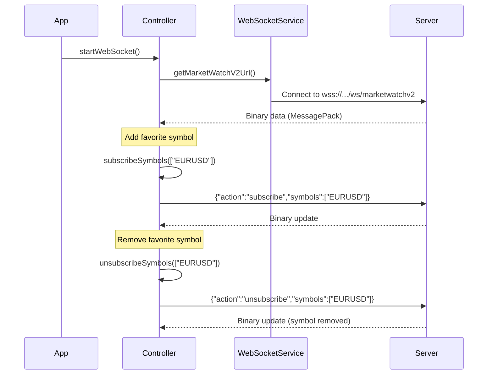

# Plan: Add marketwatchv2 WebSocket Endpoint

## Changes Required

### 1. Add New Endpoint Constant

**File:** `lib/services/websocket_endpoint_helper.dart`

Add new constant for the v2 endpoint:

```dart
static const String marketWatchV2 = '/ws/marketwatchv2';
```

Add getter method:

```dart
static String getMarketWatchV2Url(MT5Account? account) {
  return getFullUrl(marketWatchV2);
}
```

---

### 2. Update InstrumentsController for V2

**File:** `lib/controllers/instruments_controller.dart`

#### 2.1 Add subscribe method (lines ~580):

```dart
void subscribeSymbols(List<String> symbols) {
  sendEvent({
    "action": "subscribe",
    "symbols": symbols,
  });
}
```

#### 2.2 Add unsubscribe method:

```dart
void unsubscribeSymbols(List<String> symbols) {
  sendEvent({
    "action": "unsubscribe",
    "symbols": symbols,
  });
}
```

#### 2.3 Update `getSocketdata()` to use v2 URL:

```dart
void getSocketdata() async {
  // ... existing code ...
  final url = WebSocketEndpointHelper.getMarketWatchV2Url(account);
  // ... connect to new URL
}
```

---

### 3. Update WebSocket URL Getter in Service

**File:** `lib/services/unified_websocket_service.dart`

Add method to construct v2 URL in `_connectMarketWatch()` or add separate method:

```dart
Future<void> _connectMarketWatchV2() async {
  final url = WebSocketEndpointHelper.getMarketWatchV2Url(_currentAccount);
  _marketWatchChannel = WebSocketChannel.connect(Uri.parse(url));
  // ... rest of connection logic
}
```

---

### 4. Verify Binary Decoding

**File:** `lib/utils/message_pack_decoder.dart`

Ensure the decoder handles the v2 binary format correctly. The v2 format should parse array data like:

```
[symbol, bid, ask, spread_points, digits, day_high, day_low, category]
```

Existing `_parseNewFormat()` in instruments_controller.dart should handle this format.

---

### 5. Key Integration Points


| Feature                       | Location                                                    | Method                  |
| ----------------------------- | ----------------------------------------------------------- | ----------------------- |
| Initial connection params     | `instruments_controller.dart`                               | `getSocketdata()`       |
| Subscribe (add favorite)      | `instruments_controller.dart`                               | `subscribeSymbols()`    |
| Unsubscribe (remove favorite) | `instruments_controller.dart`                               | `unsubscribeSymbols()`  |
| URL endpoint                  | `websocket_endpoint_helper.dart`                            | `getMarketWatchV2Url()` |
| Binary decoding               | `message_pack_decoder.dart` + `instruments_controller.dart` | `_parseNewFormat()`     |


---

## Files to Modify

- `lib/services/websocket_endpoint_helper.dart` - Add v2 endpoint constant
- `lib/services/unified_websocket_service.dart` - Add v2 connection method
- `lib/controllers/instruments_controller.dart` - Add subscribe/unsubscribe methods, update connection

---

## Data Flow (V2)




