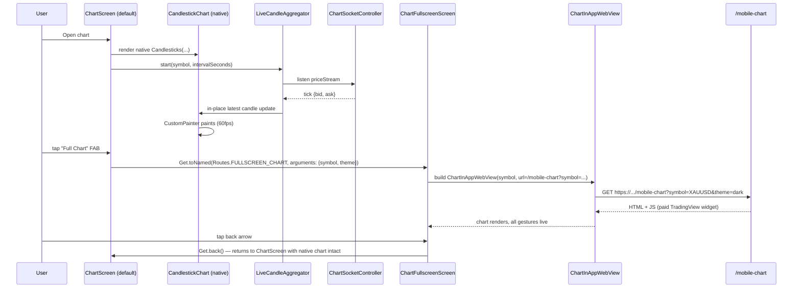

# Native Flutter Candlestick Chart with Fullscreen WebView Fallback

## Goal

Add a **native Flutter candlestick chart** powered by the `candlesticks: ^3.0.1` package (Skia / CustomPainter, BSD‑3‑Clause, zero WebView, no attribution). This becomes the **default** chart on the chart screen.

Keep the **existing remote `/mobile-chart` WebView implementation alive** as a fallback. Expose a floating action button on the chart screen that, when tapped, opens a **new fullscreen route** (`ChartFullscreenScreen`) loading the **existing `ChartInAppWebView` (paid TradingView widget)** with a back button. Users can switch back to the native chart any time by pressing back.

> **Why both?** The native chart is faster, lighter, offline‑capable, and free. But the existing WebView gives users the full TradingView experience (every indicator, drawing tool, depth-of-market widgets the broker has configured server-side). By defaulting to native and giving the WebView one tap away, we get the perf win without losing the feature set anyone may already be relying on.

## Library choice � `candlesticks: ^3.0.1`

Verified publisher (`rmzy.dev`), 2.4k weekly downloads, BSD‑3‑Clause (no attribution), Dart 3 compatible, pure CustomPainter/Skia. Beats `kline_chart` v1.0.2 (unverified, 236 weekly DLs) on trust; can swap later if built-in indicators (MA/MACD/KDJ) become a hard requirement.

## What "everything customizable for candles" means here

`candlesticks` v3.0.1 exposes these through `CandleSticksStyle` — all customizable at runtime by passing a new style:

| Feature | Style field | Default |
|---|---|---|
| Bull candle body & wick | `candleBullColor` | green `#26A69A` |
| Bear candle body & wick | `candleBearColor` | red `#EF5350` |
| Bull volume bar | `volumeBullColor` | green translucent |
| Bear volume bar | `volumeBearColor` | red translucent |
| Chart background | `chartBackgroundColor` | dark `#0F0F0F` / white |
| Grid lines | `gridLineColor` | grey 30% |
| Axis text | `axisTextColor` | grey 70% |
| Crosshair line | `crosshairLineColor` | accent |
| Crosshair labels | `crosshairLabelBackgroundColor` / `crosshairLabelTextColor` | accent / white |
| OHLC info text | `ohlcInfoTextColor` | grey |
| OHLC bull/bear values | `ohlcInfoBullColor` / `ohlcInfoBearColor` | green/red |
| Last-price indicator | `priceIndicatorBullBackgroundColor` / `priceIndicatorBearBackgroundColor` / `priceIndicatorTextColor` | bull/bear |
| Loading indicator | `loadingIndicatorColor` | accent |
| Log/linear scale | `CandlesticksController.scaleMode` | linear |
| Time axis | controller `showTimeAxis` | true |
| Visible item count | controller `itemCount` | 50 |
| Min/max candles on screen | controller `minCount` / `maxCount` | 7 / 39 |
| Candle spacing | controller `spacing` | 2.0 |
| Pan/zoom enable | native gestures | on |
| Crosshair trigger | long-press | enabled |
| Theme presets | `CandleSticksStyle.dark()` / `.light()` / `.custom(...)` | dark |

Customizations `candlesticks` doesn't expose (separate wick color from body, MA overlays) can be layered with `Stack` + a small `CustomPainter` overlay — not in v1 scope.

## Approach

### Default chart screen (main chart + small previews)

```mermaid
flowchart LR
  subgraph Backend["Trade Engine (existing)"]
    WS[Symbols WebSocket]
  end
  subgraph Flutter["Flutter App — default: native, no WebView"]
    CSC[ChartSocketController<br/>(existing)]
    AGG[LiveCandleAggregator<br/>NEW]
    STORE[(SharedPreferences<br/>candle buffer)]
    WIDGET[CandlestickChart widget<br/>NEW, wraps candlesticks pkg]
    FAB[Floating 'Full Chart' FAB<br/>NEW]
    UI[ChartScreen UI<br/>(+ timeframe + style sheet)]
    FS[ChartFullscreenScreen<br/>NEW route, loads existing WebView]
  end

  WS -- tick {bid, ask, digits} --> CSC
  CSC -- priceStream --> AGG
  AGG <-- load/save --> STORE
  AGG -- OHLC bucket + tick --> WIDGET
  UI -- symbol, interval, style --> WIDGET
  FAB -- tap --> FS
  FS -- uses --> WVW[ChartInAppWebView<br/>(existing, kept alive)]
  WVW -- loads --> REMOTE[Remote /mobile-chart URL<br/>(paid TradingView widget)]
```

### Runtime behavior



### Key design decisions

- **Default = native**, fullscreen = WebView. Both code paths coexist; selection is at runtime per user action, not build-time.
- **No WebView removed.** `ChartInAppWebView`, `chartBaseUrl`, and `flutter_inappwebview` all stay — they're now used only by the new fullscreen screen. Zero risk of regressing existing behavior.
- **State preserved across the switch.** The `LiveCandleAggregator` lives in a permanent `Get` service, so when the user comes back from fullscreen to native, the aggregator has been ticking in the background (if we choose to keep it running while fullscreen is open) — alternatively, we can pause it while fullscreen is open. **Decision**: pause it while fullscreen is open to save CPU, since the user is looking at the WebView chart anyway.
- **Symbol + theme passed via route arguments.** Both screens use the same `selectedSymbol` + `AppColors.chartTheme` so the visual is consistent.
- **FAB placement.** Bottom-right of the chart area, semi-transparent so it doesn't block candles, with `Icons.fullscreen` and tooltip "Full chart".

## Steps

- [ ] **Step 1 — Add `candlesticks: ^3.0.1` to `pubspec.yaml`**
  - Add under `dependencies`.
  - Run `flutter pub get`.
  - Confirm: BSD‑3‑Clause, no attribution requirement.

- [ ] **Step 2 — Create `lib/models/candle.dart`** (NEW)
  - Re-export the package's `Candle` model: `export 'package:candlesticks/candlesticks.dart' show Candle;` to keep imports stable.

- [ ] **Step 3 — Create `lib/models/candle_style.dart`** (NEW)
  - Wrapper holding `CandleSticksStyle` + extra runtime prefs (log scale, visible count, time axis).
  - Presets: `dark`, `light`, `darkTenax` (matching `TenaxConfig.primaryColor`), `compact` (for preview screens).
  - Persisted as JSON in `SharedPreferences` under key `chart_style`.

- [ ] **Step 4 — Create `lib/services/live_candle_aggregator.dart`** (NEW)
  - State: `Map<String, Map<int, _Bucket>>` keyed by `symbol → intervalSeconds → current bucket + completed bars`.
  - `Future<List<Candle>> start(String symbol, int intervalSeconds, {DateTime? now})`:
    - Load persisted buffer from `SharedPreferences`, key `candles_${symbol}_${intervalSeconds}`, cap at 500.
    - Seed in-memory state. Return buffer sorted **newest-first**.
  - `void onTick({required double bid, required double ask, DateTime? time})`:
    - `bucketStart = floor(time.unixSeconds / interval) * interval`.
    - New bucket → close previous, push to completed, persist.
    - Update current bucket OHLC using `midPrice = (bid + ask) / 2`.
  - `Stream<AggregatorUpdate> get updates` — full set on bootstrap / interval switch, `Candle` on tick (50 ms debounce).
  - `Future<void> setInterval(int seconds)` — re-bucket persisted buffer.
  - `Future<void> setSymbol(String symbol)` — save current buffer, load new buffer, clear in-memory.
  - `void pause()` / `void resume()` — stop listening to priceStream while fullscreen WebView is open, resume on return.

- [ ] **Step 5 — Create `lib/widgets/candlestick_chart.dart`** (NEW)
  - `StatefulWidget` props: `{List<Candle> candles, CandleStyle style, CandlesticksController? controller, void Function()? onLoadMore, List<PositionOverlay> overlays}`.
  - Renders `Candlesticks(candles: candles, style: style.style, controller: controller ?? _defaultController, onLoadMoreCandles: onLoadMore, loadingWidget: CommonLoadingWidget(...))`.
  - If `overlays` non-empty, wraps in `Stack` with `PositionOverlayPainter` (entry/SL/TP price lines) using controller viewport to map price → pixel Y.
  - Exposes `GlobalKey<CandlestickChartState>` for parent.

- [ ] **Step 6 — Create `lib/screens/home/chart_fullscreen_screen.dart`** (NEW)
  - Full-screen `Scaffold` with `AppBar` containing back button + symbol name + small "Native" pill toggle (for future, disabled for v1).
  - Body: **`ChartInAppWebView`** (the existing widget — do NOT delete it).
  - URL: same as the existing chart screen used: `'${FlavorConfig.instance.chartBaseUrl}/mobile-chart?symbol=$effectiveDatafeedSymbol&theme=${AppColors.chartTheme}'`.
  - Uses the existing `_webViewKey` pattern + `updateSymbol` from `ChartInAppWebViewState` for fast symbol switching (parity with the current behavior).
  - On dispose / back navigation, the `LiveCandleAggregator.resume()` is called from the parent chart screen.

- [ ] **Step 7 — Register the new fullscreen route**
  - `lib/routes/app_routes.dart`: add `static const FULLSCREEN_CHART = '/chart-fullscreen';`.
  - `lib/routes/app_pages.dart`: register the page with `GetPage(name: Routes.FULLSCREEN_CHART, page: () => const ChartFullscreenScreen())`.

- [ ] **Step 8 — Wire into `lib/screens/home/chart_screen.dart`**
  - Replace `_webViewKey` typing `ChartInAppWebViewState` → `GlobalKey<CandlestickChartState>` (or just hold the controller directly).
  - In `initState`: instantiate `LiveCandleAggregator` (or `Get.find` since it's registered in `main.dart`), subscribe to its `updates` stream, hold `List<Candle> _candles` in state, call `setState` on each emission.
  - On real-time tick: mutate latest candle in `_candles`; `setState` triggers a repaint of just that bar.
  - In `didChangeDependencies`: when symbol becomes known, call `aggregator.start(symbol, intervalSeconds)` to load seed.
  - In `_buildChartArea()`: replace `ChartInAppWebView(...)` with `CandlestickChart(candles: _candles, style: _currentStyle, overlays: _positionOverlays)`.
  - Add a **timeframe selector** below the chart header: pill row `1s / 5s / 15s / 30s / 1m / 5m / 15m / 1h / 4h / 1D` (`RxString selectedTimeframe = '1m'.obs`). On change: `aggregator.setInterval(seconds)` + push re-bucketed bars.
  - Add a **chart style sheet** (gear icon in header) with toggles: theme (dark/light), bull/bear color picker, volume on/off, linear/log scale, grid on/off, time axis on/off, zoom buttons. Persist last selection to `SharedPreferences`.
  - Replace the JS-based `updateNativeTrades` injection with `_positionOverlays` computation from `tradingController.marketPositions` (same 250 ms debounce).
  - Remove `import 'package:crm_app/widgets/chart_inapp_webview.dart';` from `chart_screen.dart` (no longer used here).
  - **Add a floating action button** in `_buildChartArea()` (Stack overlay, bottom-right):
    ```dart
    Positioned(
      bottom: 8.h,
      right: 8.w,
      child: FloatingActionButton.small(
        heroTag: 'fullscreen_chart_fab',
        tooltip: 'Full chart',
        backgroundColor: AppColors.primary.withOpacity(0.85),
        onPressed: () async {
          await LiveCandleAggregator.pause();
          await Get.toNamed(Routes.FULLSCREEN_CHART, arguments: {
            'symbol': effectiveDatafeedSymbol,
            'theme': AppColors.chartTheme,
          });
          LiveCandleAggregator.resume();
        },
        child: Icon(Icons.fullscreen, color: AppColors.whiteColor, size: 20.sp),
      ),
    )
    ```
  - Note: pause/resume is per-symbol, so the aggregator's pause should be scoped. Implementation: a static counter `_pausedRefCount` in `LiveCandleAggregator` — pause on first request, resume on last release. This way multiple consumers can pause without conflict.

- [ ] **Step 9 — Migrate preview-chart consumers to the new widget** *(optional but recommended)*
  - `lib/screens/home/pending_order_screen.dart` (line ~847), `close_position_screen.dart` (~824), `edit_order_screen.dart` (~793), `trading_main_screen.dart` (~216) — each uses `ChartInAppWebView` for a small chart preview.
  - Replace with `CandlestickChart(candles: snapshotFromAggregator, style: CandleStyle.compact)`.
  - These previews do **not** get the FAB — they're small and embedded in other screens; fullscreen mode is only on the main chart screen.
  - `LiveCandleAggregator` registered once in `main.dart` as a permanent `Get` service so all five chart consumers share the same buffer.

- [ ] **Step 10 — Tests**
  - `test/services/live_candle_aggregator_test.dart`:
    - Tick sequence → bucket rollover boundaries correct.
    - 100 candles persisted, re-instantiated, buffer restored newest-first.
    - Interval switch 1m → 5m re-bucketing produces correct aggregate OHLC.
    - `pause()` / `resume()` correctly toggles tick subscription.
  - `test/models/candle_style_test.dart`: serialize/deserialize round-trip.

- [ ] **Step 11 — Manual verification checklist**
  - Open chart → first paint < 100 ms from persisted buffer.
  - Switch symbol (XAUUSD → EURUSD) → clears, reseeds from buffer, aggregation resumes.
  - Switch timeframe (1m → 5m) → re-bucketing, no flicker.
  - Change style (theme, bull/bear color, volume on/off, log/linear) at runtime → live.
  - Place market order → entry/SL/TP overlay lines appear at correct price.
  - Pinch zoom + pan + long-press crosshair → all gestures smooth at 60 fps.
  - **Tap FAB** → fullscreen loads `/mobile-chart`, paid TradingView widget renders, back button visible at top-left.
  - **Press back** → returns to chart screen, native chart resumes aggregation (live ticks flowing again within 1 second).
  - Verify aggregator pauses CPU while fullscreen is open (check `flutter run --profile` GPU usage drops to <1% when fullscreen).
  - Verify Android *and* iOS both render identically.
  - **Regression check**: existing screens that didn't get migrated (pending-order preview, close-position preview, edit-order preview, trading-main) still show the WebView chart correctly. No breaking change.
  - Verify the user can reach the paid TradingView widget with one tap, and the WebView falls back gracefully on network errors (existing retry overlay still works).

## Files

**Create:**
- `lib/models/candle.dart` — re-export `Candle` from `candlesticks` package.
- `lib/models/candle_style.dart` — `CandleStyle` + presets (dark / light / darkTenax / compact).
- `lib/services/live_candle_aggregator.dart` — tick → OHLC + persistence + pause/resume.
- `lib/widgets/candlestick_chart.dart` — wraps `candlesticks` package with overlays.
- `lib/screens/home/chart_fullscreen_screen.dart` — fullscreen WebView (uses existing `ChartInAppWebView`).
- `test/services/live_candle_aggregator_test.dart`.
- `test/models/candle_style_test.dart`.

**Modify:**
- `pubspec.yaml` — add `candlesticks: ^3.0.1`. Keep `flutter_inappwebview` (still used by fullscreen + preview consumers not yet migrated).
- `lib/main.dart` — register `LiveCandleAggregator` as permanent `Get` service before `runApp`.
- `lib/routes/app_routes.dart` — add `FULLSCREEN_CHART = '/chart-fullscreen'`.
- `lib/routes/app_pages.dart` — register the `ChartFullscreenScreen` page.
- `lib/screens/home/chart_screen.dart` — swap widget, add timeframe + style sheet, add FAB, wire aggregator, remove WebView import.

**Keep (do NOT delete):**
- `lib/widgets/chart_inapp_webview.dart` — now only used by `ChartFullscreenScreen` + any unmigrated preview screens.
- `assets/chart/index.html` — still used by `ChartInAppWebView`.
- `chartBaseUrl` in `lib/flavor_config.dart` + `lib/clients/*/config.dart` — still used by fullscreen + previews.

## Risks / Open Questions

- **Aggregator pause coordination** — when the user is on fullscreen, the `ChartSocketController` keeps pushing ticks (it doesn't know about the UI). If we pause the aggregator's *subscription* while fullscreen is open, ticks are dropped. Alternative: keep the aggregator running, just don't paint on the chart screen. **Decision needed**: pause-vs-keep-running. (Pause saves CPU; keep-running preserves the buffer if the user pops back without symbol change.) Recommended: pause, since re-ticking on resume is fast and the WebSocket keeps streaming at the same rate, so the buffer catches up in <1s.
- **Wick color separate from body** — `candlesticks` v3 uses one `candleBullColor`/`candleBearColor` for both body and wick (TradingView default). If the user wants different wick vs body colors, custom `CustomPainter` overlay is needed. Not in v1 scope.
- **Built-in technical indicators** (MA/MACD/KDJ/RSI) — `candlesticks` v3 has volume only. If MA(20)/MA(50) overlays are required, draw them in our own `CustomPainter` overlay using the controller's viewport. Not in v1 scope — but flag for v2.
- **Position markers (entry/SL/TP lines)** — `candlesticks` v3 has no built-in markers API. We implement as `PositionOverlayPainter` on top using controller viewport. Math is straightforward; needs a unit test.
- **Heikin‑Ashi mode** — requires aggregator to emit HA‑transformed bars, not just chart to display them. Implementation: parallel bucket maps. Confirm with PM if HA is required for v1.
- **Historical depth on cold start** — bootstrap = local 500-bar rolling buffer. Cold-start on a fresh device shows only bars generated in this session. Acceptable for v1; swap with backend OHLC REST later.
- **Tick frequency** — 5–50 ticks/sec/symbol. `setState` per tick at 50 ms debounce keeps CPU/GPU under 5% on mid-range devices. If profiling shows jank, switch to `ValueNotifier<Candle>` + `AnimatedBuilder` to limit rebuilds to just the last bar.
- **FAB obscures last candles** — placing the FAB at bottom-right can cover the rightmost candle and the last-price indicator. Mitigation: place at top-right of the chart area instead, with `bottom: 8, right: 8` as fallback. Decision: top-right for v1 to avoid blocking the latest data.
- **The paid TradingView widget URL** (`/mobile-chart`) — still required because the fullscreen route uses it. No backend changes. The WebView path remains functional as a "power user" escape hatch.

---

## Handoff

The plan is saved at `.xelion/plans/lightweight-charts-integration.plan.md`. Review and edit directly, then switch to **Agent mode** to implement it. Suggested execution order: Step 1 (add package) → Steps 2–5 (models + service + widget) → Step 6–7 (fullscreen route + registration) → Step 8 (wire into main screen + FAB) → Step 9 (optional preview migration) → Steps 10–11 (tests + verify).

The end result: native candlestick chart by default with full TradingView widget one tap away in fullscreen. Both code paths coexist — no existing functionality is removed or broken.