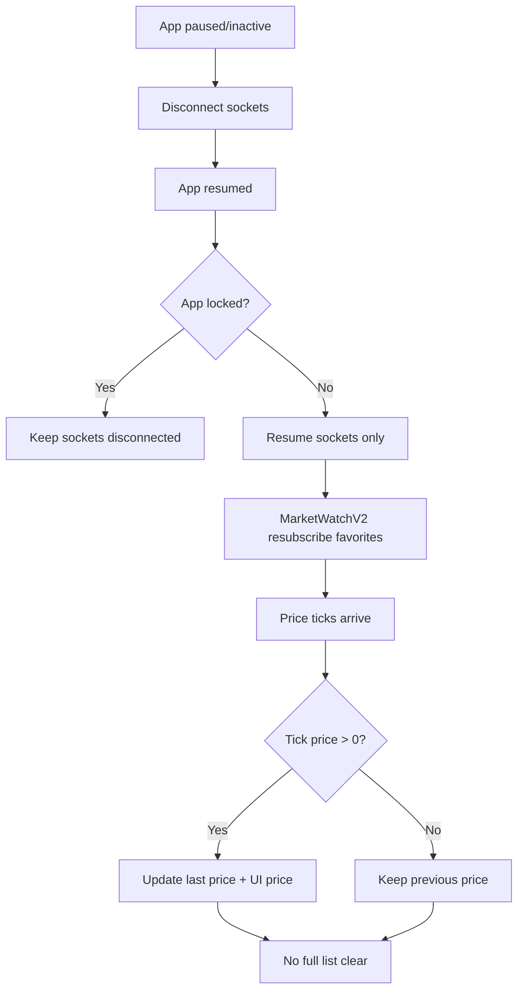

# Prevent Full Refresh on App Resume and Preserve Last Prices

## Goal
When the app returns from minimized/background/notification-center flows, reconnect WebSocket pricing without rebuilding or clearing the whole instruments screen. Prices should never display `0`; if a reconnect or REST hydrate returns `0`, keep showing the last non-zero bid/ask/spread/high/low until a valid new value arrives.

## Approach
Use the existing central lifecycle coordination in `AccountController`, but split **app resume reconnect** from **real account switch** behavior. On resume/unlock, reconnect and resubscribe sockets without calling full account refresh or clearing instrument/trading lists. In `InstrumentsController`, preserve a last-known non-zero price cache and ignore zero price fields during hydrate/reconnect ticks.

Key decisions:
- Keep `clearAllTradingData()` / `clearInstrumentsData()` for actual account switches only.
- Add a dedicated resume path, e.g. `resumeSocketsForCurrentAccount()`, that reconnects services and resubscribes without clearing lists.
- Remove or avoid `refreshAccounts()` on app resume because it calls `syncMT5Accounts()` + `loadAccounts()` and can trigger broad UI state refresh.
- Hydrate favorite rows from REST without overwriting existing non-zero price values with placeholder zeros.
- Treat `0` bid/ask/high/low/spread from reconnect snapshots as invalid when a previous non-zero value exists.

## Steps
- [x] Step 1 — Update `lib/controllers/account_controller.dart` lifecycle resume flow so `didChangeAppLifecycleState(AppLifecycleState.resumed)` does **not** call `reconnectAllSocketsForAccount()` or `refreshAccounts()` for normal foreground return. Instead call a new resume-only method that reconnects/resubscribes sockets without clearing UI state.
- [x] Step 2 — Update the `AppLockService.isLocked` listener in `lib/controllers/account_controller.dart` so unlock-while-resumed also uses the same resume-only socket method and avoids full `refreshAccounts()` unless an account switch or explicit user refresh requires it.
- [x] Step 3 — Add a new method in `lib/controllers/account_controller.dart`, e.g. `resumeSocketsForCurrentAccount()`, that reconnects current-account sockets without clearing data:
  - `UnifiedWebSocketService.switchAccount(activeAccount)` only if needed for the same account session.
  - `InstrumentsController.startWebSocket()` or `MarketWatchV2Service.reconnectAndResyncFavorites()` without `clearInstrumentsData()`.
  - `TradingWebSocketService.reconnect()` / `forceRefreshTradingData()` without `TradingController.clearAllTradingData()`.
  - `AccountWebSocketService.reconnect()` / `requestAccountData()` only if balance/account header must refresh.
  - `DashboardController.unsubscribeAndResubscribe()` only if it does not cause visible full-screen reload; otherwise skip on lifecycle resume.
- [x] Step 4 — Keep `reconnectAllSocketsForAccount()` and `_reconnectAllSockets()` in `lib/controllers/account_controller.dart` for **actual account switch** behavior, but avoid using them from lifecycle resume. This preserves the existing clear-and-rebind behavior when the account truly changes.
- [x] Step 5 — Update `lib/controllers/instruments_controller.dart` price handling. Change `_applyPriceUpdate(ListElement item)` so it merges with `priceRx(item.symbol).value` and only replaces bid/ask/spread/dayLow/dayHigh when the incoming value is non-zero; if incoming is `0`, retain the previous non-zero value.
- [x] Step 6 — Update `lib/controllers/instruments_controller.dart` `hydrateFavoritesFromRest()` so REST-created favorite rows with `bid: 0`, `ask: 0`, `spreadDiff: 0`, `dayHigh: null`, `dayLow: null` do not reset `priceRx` to zeros. It should only create missing rows and keep current `InstrumentPrice` for existing symbols.
- [x] Step 7 — Update `lib/controllers/instruments_controller.dart` `_parseInstrumentItem()` or the call sites (`_parseSingleInstrument`, `_parseNewFormat`) so invalid zero ticks are sanitized before `_applyPriceUpdate()`. The safest place is `_applyPriceUpdate()` because all price paths converge there.
- [x] Step 8 — Update `lib/controllers/instruments_controller.dart` `stopWebSocket()` and `disconnectWebSocket()` behavior if needed so lifecycle disconnect does not set `_isClearingData = true` or block future `marketwatchv2` decoded frames indefinitely. Use clearing flags only for account-switch/full-reset paths, not simple background disconnect.
- [x] Step 9 — Review `lib/screens/home/instruments_screen.dart` loading condition. Ensure normal resume/reconnect does not show `CommonLoadingWidget` if `allInstruments` already has rows; only show the loader for first load or genuinely empty data.
- [ ] Step 10 — Validate manually with these cases: *(code changes are complete; needs device/runtime QA because lifecycle/background behavior cannot be fully validated by static analysis here)*
  - App minimized then foregrounded.
  - App foregrounded, notification center opened, then returned.
  - App opened, switched to another app, then returned.
  - Account switch still clears/reloads correctly.
  - During reconnect, bid/ask never display `0` if previous non-zero values exist.

## Files
- `lib/controllers/account_controller.dart` — Separate lifecycle resume reconnect from full account-switch reconnect; stop full account refresh on resume.
- `lib/controllers/instruments_controller.dart` — Preserve last non-zero prices and avoid list clearing/zero price overwrite during reconnect.
- `lib/services/market_watch_v2_service.dart` — Possibly reuse or lightly adjust `reconnectAndResyncFavorites()` for resume-only resubscribe.
- `lib/screens/home/instruments_screen.dart` — Verify loader condition does not cause visible full-screen refresh when reconnecting with existing data.

## Risks / Open questions
- If backend account data must refresh on every foreground for balance/margin, skipping `refreshAccounts()` may delay account header updates; consider refreshing only account header socket data instead of full account list.
- `DashboardController.unsubscribeAndResubscribe()` may still cause visible refresh depending on implementation; inspect before using in resume-only flow.
- If a legitimate market price can be exactly `0` for some synthetic symbol, filtering zero would hide it; for trading instruments this is normally safe.
- `MarketWatchV2Service` currently reconnects by disconnecting and resubscribing favorites; confirm it does not emit placeholder zero snapshots that overwrite UI after the controller changes.