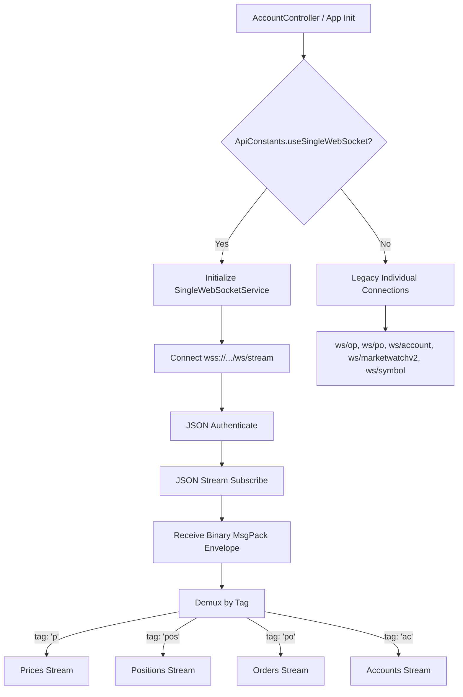

# Single WebSocket Stream Integration Plan

## Goal
Implement a new multiplexed WebSocket service connecting to the `/ws/stream` endpoint, replacing the old 4-socket connections (market watch, symbols, positions, orders, account data) with a single binary MessagePack-encoded connection. This improves app performance, avoids connection lag, and runs in parallel with the old system controlled via a single boolean switch.

## Approach
We will introduce a new GetX service `SingleWebSocketService` that manages the `/ws/stream` connection. If the toggle flag `useSingleWebSocket` is active, other controllers and services will subscribe to this new service's streams rather than initializing their own raw `WebSocketChannel` instances.

### Key Architectural Decisions:
1. **No changes to legacy logic:** We keep the original endpoints and connection code intact. A static boolean `ApiConstants.useSingleWebSocket` controls the active path.
2. **Payload Normalization:** Since `/ws/stream` binary payloads omit some action wrappers (like `'op'` and `'po'`) that the legacy parser expects at index 1, we will normalize the incoming payloads in the adapters before passing them to the handlers.
3. **Control Messages:** We will extend `_handleSocketMessage` in `TradingWebSocketService` and `AccountWebSocketService` to accept pre-decoded lists and maps directly without attempting JSON/msgpack decoding again.
4. **Lifecycle & Auto-Refresh:** We preserve the exact auto-refresh timers. In `TradingWebSocketService`, the periodic refresh timer (every 30 seconds) will resend the stream subscription request to `/ws/stream`, trigger fresh initial snapshots, and replace the local UI state cleanly without clearing lists.

---

## Technical Specifications from WEBSOCKET_STREAM_API.md

Every binary frame received is decoded from MessagePack into a 2-element envelope: `[tag, payload]`.

### 1. Prices (tag: `"p"`)
* Payload represents either a single price tick or a batch of price ticks.
* **Format:**
  * Single: `[symbol, bid, ask, spread, digits, timestamp]`
  * Batch: `[[symbol, bid, ask, spread, digits, timestamp], ...]`
* **Field Indices:**
  * `0`: symbol (String)
  * `1`: bid (double)
  * `2`: ask (double)
  * `3`: spread points (double/num)
  * `4`: digits (int)
  * `5`: timestamp in ms (num)

### 2. Positions (tag: `"pos"`)
* Payload represents a single position update or a batch of position updates.
* **Format:** `[action, ...]` or `[[action, ...], ...]`
* **Actions:**
  * **`'op'` (Open Snapshot) / `'a'` (Add Position) / `'u'` (Update Position):**
    * `0`: action (`"op"`, `"a"`, or `"u"`)
    * `1`: position_id (int)
    * `2`: account (String)
    * `3`: symbol (String)
    * `4`: side (`0`=BUY, `1`=SELL)
    * `5`: volume/lots (double)
    * `6`: open price (double)
    * `7`: current price (double)
    * `8`: profit (double)
    * `9`: swap (double)
    * `10`: SL (double)
    * `11`: TP (double)
    * `12`: server type (String)
    * `13`: open time in seconds (int)
    * `14`: digits (int)
    * `15`: contract size (double)
  * **`'r'` (Remove Position):**
    * **Format:** `['r', account, ...position_ids]`
    * `0`: action (`"r"`)
    * `1`: account (String)
    * `2+`: position_ids (varargs or flat list of numbers/strings)

### 3. Pending Orders (tag: `"po"`)
* Payload represents a single order update or a batch of order updates.
* **Format:** `[action, ...]` or `[[action, ...], ...]`
* **Actions:**
  * **`'po'` (Snapshot) / `'a'` (Add Order) / `'u'` (Update Order):**
    * `0`: action (`"po"`, `"a"`, or `"u"`)
    * `1`: order_id (int)
    * `2`: account (String)
    * `3`: symbol (String)
    * `4`: order type (`2`=BUY LIMIT, `3`=SELL LIMIT, `4`=BUY STOP, `5`=SELL STOP)
    * `5`: volume/lots (double)
    * `6`: order price (double)
    * `7`: current price (double)
    * `8`: SL (double)
    * `9`: TP (double)
    * `10`: server type (String)
    * `11`: created time in seconds (int)
    * `12`: swap (double)
    * `13`: digits (int)
  * **`'r'` (Remove Order):**
    * **Format:** `['r', account, order_id]`
    * `0`: action (`"r"`)
    * `1`: account (String)
    * `2`: order_id (int)

### 4. Accounts (tag: `"ac"`)
* Payload represents a batch of account data arrays.
* **Format:** `[['ac', account_number, balance, credit, equity, margin, free_margin, margin_level, profit, server_type]]`
* **Field Indices:**
  * `0`: tag (`"ac"`)
  * `1`: account number (String)
  * `2`: balance (double)
  * `3`: credit (double)
  * `4`: equity (double)
  * `5`: margin (double)
  * `6`: free margin (double)
  * `7`: margin level % (double)
  * `8`: profit (double)
  * `9`: server type (String)

---

## Payloads Normalization Logic (Adapter/Bridge)

Since the legacy parsers expect certain tags (`'op'` or `'po'`) at index 1 for compatibility:
1. **Positions (`'a'` / `'u'`):** Insert `'op'` at index 1 -> `[action, 'op', position_id, account, ...]`.
2. **Positions `'r'`:** Convert bulk remove `['r', account, id1, id2]` to `['r', account, [id1, id2]]`.
3. **Orders (`'a'` / `'u'` / `'po'`):** Insert `'po'` at index 1, and ensure `'po'` action is renamed to `'a'` -> `[action, 'po', order_id, account, ...]`.
4. **Accounts:** Already matches the legacy list format. No changes needed.

---

## Steps

- [x] **Step 1: Declare Flag**
  Add a toggle boolean flag `static const bool useSingleWebSocket = true;` in `lib/constants/api_const.dart`.
  
- [x] **Step 2: Create SingleWebSocketService**
  Create `lib/services/single_websocket_service.dart` containing `SingleWebSocketService` extending `GetxService`. It will handle:
  - WebSocket connection to `/ws/stream`.
  - JSON Authentication (`{"type": "authenticate", "authID": "<token>", "trading_account": "<account>"}`) and stream subscription handshake (`{"type": "stream_subscribe", "channels": ["prices", "positions", "orders", "accounts"]}`).
  - MessagePack decoding of binary frames.
  - Demultiplexing based on tags (`'p'`, `'pos'`, `'po'`, `'ac'`) and emitting on broadcast streams.
  - Reconnection handling with exponential backoff.
  - Account switching with manual unsubscription / re-authentication.

- [x] **Step 3: Register Service in Main & AuthController**
  - In `lib/main.dart` inside `initServices()`, initialize the new service: `Get.put<SingleWebSocketService>(SingleWebSocketService(), permanent: true)`.
  - In `lib/controllers/auth_controller.dart`, add cleanup logic to reset/delete `SingleWebSocketService` during logouts and session resets.

- [x] **Step 4: Update AccountController Lifecycle Coordination**
  In `lib/controllers/account_controller.dart`:
  - Inside `_reconnectAllSockets`, if `useSingleWebSocket` is true, call `singleWS.switchAccount(account)` and proceed to trigger sequential bind/start calls in controllers (which will conditionalize their listeners on the flag).
  - Inside `resumeSocketsForCurrentAccount`, call `singleWS.connect()` if `useSingleWebSocket` is enabled.

- [x] **Step 5: Integrate with InstrumentsController (Prices)**
  In `lib/controllers/instruments_controller.dart`:
  - Update `_bindMarketWatchV2DecodedListener()` to subscribe to `singleWS.pricesStream` if `useSingleWebSocket` is enabled.
  - Update `startMarketWatchV2Only()` and `resumePriceStreamOnly()` to connect to the single socket and call `singleWS.subscribeSymbols(...)` for current favorites instead of starting `MarketWatchV2Service` socket.
  - Update `syncMarketWatchV2AfterFavoriteChange()` to forward additions/removals to `singleWS` instead of `MarketWatchV2Service`.
  - Update `stopWebSocket()` to only disconnect/cancel subscription to `pricesStream` and avoid killing the shared socket.

- [x] **Step 6: Integrate with TradingWebSocketService (Positions & Orders)**
  In `lib/services/trading_websocket_service.dart`:
  - Update `_handleSocketMessage()` to check if the incoming message is already decoded (`message is List || message is Map`) and skip decoding.
  - Update `_connectToOpenPositions()` and `_connectToPendingOrders()`. If `useSingleWebSocket` is true, cancel previous subscriptions, listen to `singleWS.positionsStream` / `singleWS.ordersStream` respectively, and map/normalize the incoming array events to the legacy formats (`normalizePositionPayload`/`normalizeOrderPayload`) before passing to handlers.
  - Skip opening direct connections to `/ws/op` and `/ws/po` when the single socket is enabled.
  - Update `_requestTradingData()` to trigger a snapshot refresh via resending the stream subscription payload when `useSingleWebSocket` is active.

- [x] **Step 7: Integrate with AccountWebSocketService (Account Metrics)**
  In `lib/services/account_websocket_service.dart`:
  - Update `_handleSocketMessage()` to accept pre-decoded lists/maps directly.
  - Update `_initializeWebSocket()`. If `useSingleWebSocket` is true, listen to `singleWS.accountsStream` and pass messages directly to `_handleSocketMessage()`, skipping raw connection calls.

- [x] **Step 8: Integrate with ChartSocketController (Chart Ticks)**
  In `lib/controllers/chart_socket_controller.dart`:
  - In `initializeWebSocket()`, if `useSingleWebSocket` is true, connect to the single socket, subscribe to the active chart symbol using `singleWS.subscribeSymbols([currentSymbol.value])`, listen to `singleWS.pricesStream`, unpack batches, and process the ticks, skipping the legacy `/ws/symbol` connection.

---

## Files

- `lib/constants/api_const.dart` — Add the `useSingleWebSocket` toggle boolean.
- `lib/services/single_websocket_service.dart` — Create the new single multiplexed binary WebSocket service.
- `lib/main.dart` — Register the new service in `initServices()`.
- `lib/controllers/auth_controller.dart` — Clean up the service state during auth/logout cycles.
- `lib/controllers/account_controller.dart` — Switch accounts and manage lifecycles on the single socket.
- `lib/controllers/instruments_controller.dart` — Route watchlist price ticks from the new `pricesStream`.
- `lib/services/trading_websocket_service.dart` — Route and normalize position/order stream updates, and skip legacy connections.
- `lib/services/account_websocket_service.dart` — Route account metric stream updates, and skip legacy connection.
- `lib/controllers/chart_socket_controller.dart` — Route and filter symbol ticks for charts, and skip legacy connection.

---

## Risks / Open questions

1. **Additional memory/CPU overhead of MessagePack decoding:** Since we're parsing all data on a single channel, we decode MessagePack arrays inside the service before routing. However, this is significantly faster than JSON parsing (as documented in `MessagePackDecoder`) and resolves multi-socket lag.
2. **Channel subscription overlaps:** Multiple screens (watchlist, chart, trading) may subscribe to the same or different symbols. `SingleWebSocketService` tracks `_subscribedSymbols` as a `Set` to ensure the underlying stream receives updates for all relevant symbols without duplication.
3. **Re-authentication on connection loss:** In single socket mode, when a connection drops, we need a complete handshake: connect -> auth -> stream_subscribe. Our reconnection logic is designed to fully re-authenticate and re-subscribe all active channels/symbols.
