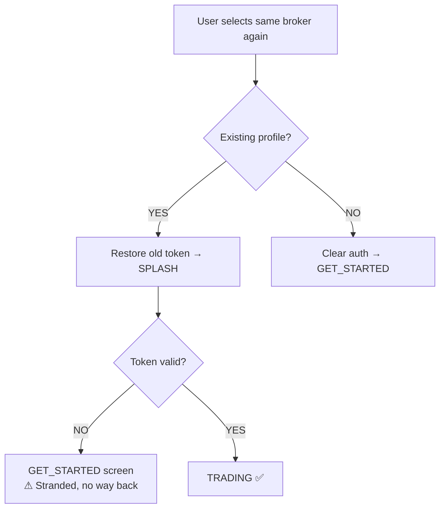
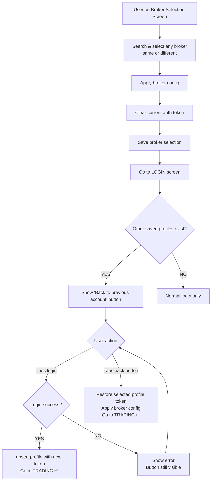
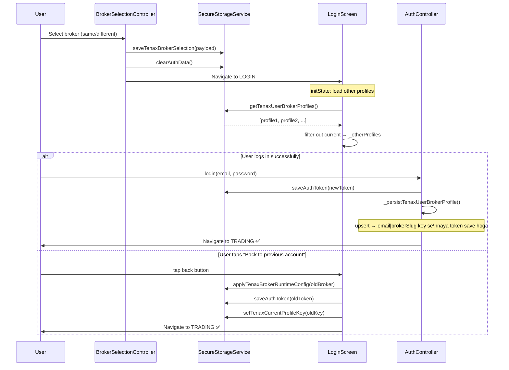

# Tenax Multibroker: Same Broker Re-Login + Previous User Fallback

## Goal
User same broker dobara freely search karke add kar sake aur fresh login kar sake. Agar login fail ho ya user app use kar raha ho, to woh apne **kisi bhi pehle wale saved account** par — chahe same broker ho ya alag — "Back to previous account" button se wapis ja sake. Har user-broker combination ka **auth token independently** store hoga taaki koi bhi token doosre ko overwrite na kare.

---

## Current Problems



**Problem 1:** Same broker dobara select karne par old token restore ho jaata hai aur SPLASH pe jaata hai — user fresh login nahi kar sakta.

**Problem 2:** Login fail hone par user stranded reh jaata hai — pehle wale kisi bhi account par wapis jaane ka koi rasta nahi.

**Problem 3:** Auth token ek hi jagah store hota hai (`auth_token` key) — jab bhi broker switch hota hai, active token overwrite ho jaata hai. Purane profile ka token `login_data` mein save hota hai par woh primary key nahi hai.

---

## Approach

### Token Management
- Existing `login_data` structure mein token pehle se save hota hai per-profile (`email|brokerSlug` key se)
- Koi naya storage structure banana ki zaroorat nahi — `SecureStorageService.upsertTenaxUserBrokerProfile()` already yeh karta hai
- **Change:** `selectBroker()` mein same broker ke liye existing profile check hone par bhi **auth clear karo** aur seedha `LOGIN` pe bhejo — taaki fresh login ho sake

### Same Broker Re-Add
- Koi confirm dialog nahi, koi block nahi
- Same broker select karo → broker config apply karo → current auth clear karo → `LOGIN` screen pe bhejo
- Login success hone par `_persistTenaxUserBrokerProfile()` profile update kar dega (upsert se same key overwrite hogi)

### "Back to Previous Account" Fallback
- `LoginScreen` mein `initState` pe **saare saved profiles load karo** (current wale ko exclude karke)
- Agar koi bhi other profile ho → bottom area mein button/link dikhao
- Tap karne par: us profile ka token restore karo, broker config apply karo, TRADING pe bhejo

---

## Detailed Flow After Fix



---

## Steps

- [x] **Step 1 — `selectBroker()` mein: same broker ho ya naya, hamesha auth clear karo aur LOGIN pe bhejo**
  - File: `lib/controllers/tenax_broker_selection_controller.dart`
  - `selectBroker()` ke andar existing logic change karo:
    - `existingProfile != null` branch: pehle SPLASH pe bhejta tha → **ab auth clear karo aur LOGIN pe bhejo**
    - `existingProfile == null` branch: GET_STARTED pe bhejta tha → **ab bhi LOGIN pe bhejo** (GET_STARTED sirf tab chahiye jab koi broker hi na ho)
    - Reason: User broker choose kar chuka hai, GET_STARTED unnecessary hai; fresh login seedha LOGIN se hona chahiye
  - Specifically change karo:
    ```
    // OLD (existingProfile != null):
    Get.offAllNamed(AppPages.SPLASH);

    // NEW (existingProfile != null OR null):
    await SecureStorageService.clearAuthData();
    await SecureStorageService.saveLoginStatus(false);
    Get.offAllNamed(
      FlavorConfig.isTenaxBrokerDemoEnabled ? AppPages.LOGIN : AppPages.LOGIN,
    );
    ```
  - Note: `broker_data` aur `broker_runtime_config` already save ho jaata hai `saveTenaxBrokerSelection()` se — yeh change nahi hoga

- [x] **Step 2 — `LoginScreen` mein other saved profiles load karo**
  - File: `lib/screens/auth/getstart/login_screen.dart`
  - `_LoginScreenState` mein add karo:
    ```dart
    List<Map<String, dynamic>> _otherProfiles = [];
    bool _multibrokerEnabled = false;
    ```
  - `initState()` mein existing `_tryBiometricLogin()` call ke baad, ek naya async call add karo:
    ```dart
    _loadOtherProfiles();
    ```
  - Naya method add karo:
    ```dart
    Future<void> _loadOtherProfiles() async {
      if (!FlavorConfig.isMultiBrokerEnabled) return;
      final isEnabled = await SecureStorageService.getTenaxBrokerSelectionFlag();
      if (!isEnabled) return;

      final allProfiles = await SecureStorageService.getTenaxUserBrokerProfiles();
      final currentKey = await SecureStorageService.getTenaxCurrentProfileKey();

      // Filter out current profile — baaki sab "other" hain
      final others = allProfiles
          .where((p) => (p['profile_key'] ?? '') != currentKey)
          .toList();

      if (!mounted) return;
      setState(() {
        _multibrokerEnabled = true;
        _otherProfiles = others;
      });
    }
    ```

- [x] **Step 3 — `LoginScreen` UI mein "Back to previous account" button add karo**
  - File: `lib/screens/auth/getstart/login_screen.dart`
  - Login button ke neeche aur "Don't have account" ke upar, condition se button add karo:
    ```dart
    if (_multibrokerEnabled && _otherProfiles.isNotEmpty) ...[
      SizedBox(height: 8.h),
      _buildBackToPreviousAccountButton(),
    ],
    ```
  - Agar sirf **ek** other profile hai:
    ```dart
    TextButton(
      onPressed: () => _switchToProfile(_otherProfiles.first),
      child: Text('← Back to ${_otherProfiles.first['user_name'] ?? 'previous account'} (${_otherProfiles.first['broker_name'] ?? ''})'),
    )
    ```
  - Agar **multiple** other profiles hain → "Back to previous account" → tap pe bottom sheet (profile list, same as `more_screen.dart` ka `_showSwitchAccountBottomSheet()` style)

- [x] **Step 4 — `_switchToProfile()` method add karo `LoginScreen` mein**
  - File: `lib/screens/auth/getstart/login_screen.dart`
  - Yeh method `more_screen.dart` ke `_selectTenaxProfile()` jaisa kaam karega:
    ```dart
    Future<void> _switchToProfile(Map<String, dynamic> profile) async {
      final brokerData = profile['broker_data'] as Map<String, dynamic>?;
      if (brokerData == null) return;

      // 1. Broker config apply karo
      final runtimeConfig = (brokerData['broker_runtime_config'] as Map?)
              ?.cast<String, dynamic>() ?? brokerData;
      final selectedName = (brokerData['selected_name'] ?? '').toString();
      final selectedLogo = (brokerData['selected_logo_local_path'] ??
              brokerData['selected_logo_url'] ?? '').toString();
      FlavorConfig.applyTenaxBrokerRuntimeConfig(
        config: runtimeConfig,
        brokerName: selectedName.isNotEmpty ? selectedName : null,
        brokerLogoUrl: selectedLogo.isNotEmpty ? selectedLogo : null,
        brokerData: brokerData,
      );

      // 2. Broker selection save karo
      await SecureStorageService.saveTenaxBrokerSelection(brokerData);

      // 3. Auth token restore karo
      final loginData = profile['login_data'];
      if (loginData is Map) {
        final token = (loginData['token'] ?? '').toString();
        final wsToken = (loginData['websocket_token'] ?? '').toString();
        final userData = loginData['user'];
        if (token.isNotEmpty) {
          await SecureStorageService.saveAuthToken(token);
          await SecureStorageService.saveWebsocketToken(wsToken);
          if (userData is Map<String, dynamic>) {
            await SecureStorageService.saveUserData(
              jsonEncode({
                'token': token,
                'websocket_token': wsToken,
                'user': userData,
                'is_logged_in': true,
              }),
            );
          }
          await SecureStorageService.saveLoginStatus(true);
        }
      }

      // 4. Current profile key set karo
      await SecureStorageService.setTenaxCurrentProfileKey(
        (profile['profile_key'] ?? '').toString(),
      );

      // 5. UI refresh
      Get.find<LanguageService>().brandingUpdateIndex.value++;

      // 6. TRADING pe bhejo
      Get.offAllNamed(AppPages.TRADING);
    }
    ```
  - **Import add karo:** `dart:convert` (for `jsonEncode`)

- [x] **Step 5 — Bottom sheet profile picker (multiple profiles case)**
  - File: `lib/screens/auth/getstart/login_screen.dart`
  - Agar `_otherProfiles.length > 1` ho to `_buildBackToPreviousAccountButton()` mein:
    ```dart
    TextButton(
      onPressed: _showProfilePickerSheet,
      child: Text('← Back to previous account'),
    )
    ```
  - `_showProfilePickerSheet()` method:
    - `showModalBottomSheet` dikhao
    - `_otherProfiles` ki list dikhao (profile name + broker name + email)
    - Har item tap pe `_switchToProfile(profile)` call karo
    - Same visual style as `more_screen.dart` `_buildAccountTile()`

- [x] **Step 6 — `selectBroker()` mein `existingProfile` branch ka GET_STARTED flow bhi fix karo**
  - File: `lib/controllers/tenax_broker_selection_controller.dart`
  - Abhi `existingProfile == null` case mein:
    ```dart
    // OLD:
    Get.offAllNamed(
      FlavorConfig.isTenaxBrokerDemoEnabled ? AppPages.LOGIN : AppPages.GET_STARTED,
    );
    // NEW:
    Get.offAllNamed(AppPages.LOGIN);
    ```
  - GET_STARTED tab dikhana chahiye jab app first time launch ho aur koi broker hi select na hua ho — broker select hone ke baad seedha LOGIN aana chahiye

- [x] **Step 7 — `_persistTenaxUserBrokerProfile()` verify karo (no change needed)**
  - File: `lib/controllers/auth_controller.dart`
  - Existing `upsertTenaxUserBrokerProfile()` call `profile_key = email|brokerSlug` se dedup karta hai
  - Same user same broker pe dobara login kare to profile update ho jaayegi (token refresh)
  - Koi change nahi chahiye

---

## Auth Token Flow (Corrected)



---

## Files

| File | Change |
|------|--------|
| `lib/controllers/tenax_broker_selection_controller.dart` | `selectBroker()` mein both branches → auth clear + directly LOGIN pe bhejo |
| `lib/screens/auth/getstart/login_screen.dart` | `_loadOtherProfiles()`, `_switchToProfile()`, back button UI, profile picker bottom sheet |
| `lib/controllers/auth_controller.dart` | No change — upsert already handles token refresh |
| `lib/services/secure_storage_service.dart` | No change — per-profile token already `login_data` mein stored hai |

---

## Risks / Open Questions

- **Purana token expire ho gaya ho:** `_switchToProfile()` se TRADING pe jaane ke baad, agar token invalid hai to `authController.checkAuthStatus()` fail karega aur user wapis `GET_STARTED` pe aa jaayega (existing behavior — acceptable)
- **`mounted` check:** `_loadOtherProfiles()` async hai — agar screen jaldi dispose ho jaaye to `if (!mounted) return` zaroor rakho (already plan mein included)
- **Demo mode:** `FlavorConfig.isTenaxBrokerDemoEnabled` case mein broker auto-set hota hai — back button wahan bhi dikhega agar other profiles saved hain (correct behavior)
- **`dart:convert` import:** `login_screen.dart` mein `jsonEncode` ke liye yeh import pehle se ho ya nahi, check karna padega
