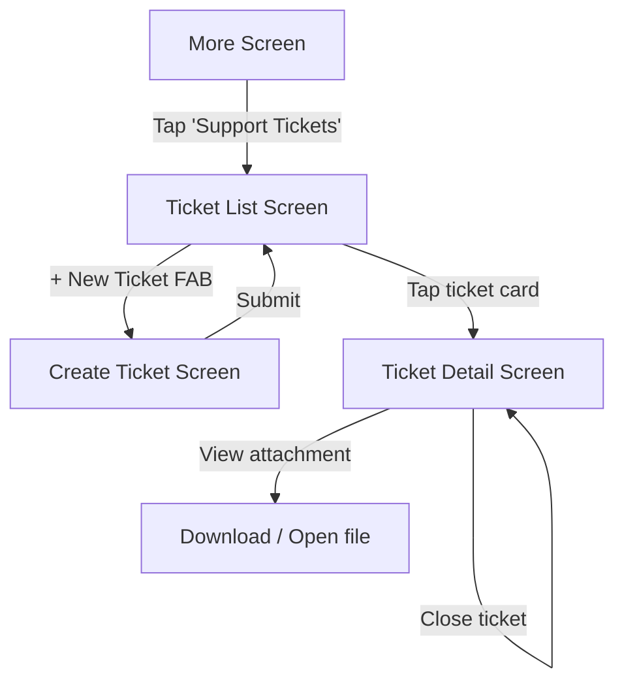

# Support Ticket Module — Mobile Implementation Plan

## Goal
Settings/More screen ke andar ek naya **Support Ticket** module add karna hai jo web design se inspire ho kar mobile-friendly compact layout me implement hoga. Features: ticket listing (with department tabs, filters, search, pagination), create ticket (with file attachment), ticket detail + conversation, reply with attachment, close ticket, aur attachment download.

## API Reference (Reusable for clone projects)

### Base Path: `user/tickets`

| # | Purpose | Method | Endpoint | Key Query Params | Notes |
|---|---------|--------|----------|------------------|-------|
| 1 | **List Departments** | GET | `user/tickets/departments` | — | Returns `[{id, name, icon}]` used for tab filter chips |
| 2 | **List Tickets** | GET | `user/tickets` | `page`, `per_page`, `status` (all/open/closed), `department` (all/id), `priority` (all/low/medium/high), `search` | Paginated. Response: `{data: [{id,title,description,department,priority,status,created_at,updated_at,assignee:{name,avatar},conversation_count}], pagination:{current_page,last_page,per_page,total}}` |
| 3 | **Create Ticket** | POST | `user/tickets` | — | Body (multipart): `department_id`, `priority`, `title`, `description`, `attachment` (file, optional). Response: `{status,success,message,data:[]}` |
| 4 | **Ticket Detail** | GET | `user/tickets/{ticketId}` | — | Returns full ticket + `conversation[]` + `attachment{filename,path,url}` |
| 5 | **Reply to Ticket** | POST | `user/tickets/{ticketId}/reply` | — | Body (multipart): `message`, `attachment` (file, optional) |
| 6 | **Close Ticket** | POST | `user/tickets/{ticketId}/close` | — | Closes the ticket |
| 7 | **Download Attachment** | GET | `user/tickets/attachment?path=...` | `path` | Returns file binary; open in browser or download |

> **Note:** Create & Reply are likely **multipart/form-data** since they accept file attachment.

---

## Approach
- Follow existing project patterns: **GetX controller** + **ApiService** + **GetX routes/bindings**
- Reuse existing `ApiService.get()`, `ApiService.post()`, `ApiService.postForm()` for API calls
- Add ticket API endpoints in `api_const.dart`
- Add routes in `app_routes.dart` / `app_pages.dart`
- Entry point: Add a **"Support Tickets"** menu item in `more_screen.dart` under Support/Account Security section
- 3 new screens, 1 controller, 1 model file — keeping it lean



---

## Screens Design (Mobile-Friendly)

### 1. Ticket List Screen (`ticket_list_screen.dart`)
- **AppBar:** Title "Support Tickets", back arrow
- **Department tab chips** (horizontal scroll): All Tickets (\count), Sales, Account, Support — from departments API
- **Search bar** + **Filter row** (Status dropdown, Priority dropdown) — compact chips/dropdowns
- **Ticket cards** (ListView): Each card shows `#id` + status badge (OPEN/CLOSED color-coded), title, description preview, department + priority + date row, assignee avatar + name
- **FAB** or AppBar action: "+ New Ticket" button
- **Pagination**: Load more on scroll (infinite scroll) or "Load More" button
- **Empty state**: "No tickets found" with "Clear Filters" button

### 2. Create Ticket Screen (`create_ticket_screen.dart`)
- **AppBar:** "New Ticket", back arrow
- **Form fields:** Department dropdown (from API), Priority dropdown (low/medium/high), Subject text field, Description multiline text field
- **Attachment section:** "Attach file" button → image picker / file picker (max 5MB, Images/PDF/DOC/DOCX)
- **Buttons:** Cancel + Create Ticket (primary)

### 3. Ticket Detail Screen (`ticket_detail_screen.dart`)
- **AppBar:** "Ticket #{id}", back arrow
- **Ticket info card** (collapsible): Reference, Status badge, Department, Created date, Priority, Assignee
- **Manage ticket** expandable: Close Ticket button (only if status == open)
- **Tab bar:** All | Attachments (count)
  - **All tab:** Conversation list (chat-style bubbles, assignee = left/purple bg, user = right/light bg) with timestamp
  - **Attachments tab:** Grid/list of attachment thumbnails with filename, date, download button
- **Reply input** (bottom pinned): TextField + Attach file button + Send/Post reply button

---

## Steps

- [x] **Step 1 — API Constants**
  Add ticket endpoints in `lib/constants/api_const.dart`:
  ```dart
  // Support Ticket APIs
  static const String ticketDepartments = '${ajax}tickets/departments';
  static const String tickets = '${ajax}tickets';
  static String ticketDetail(String ticketId) => '${ajax}tickets/$ticketId';
  static String ticketReply(String ticketId) => '${ajax}tickets/$ticketId/reply';
  static String ticketClose(String ticketId) => '${ajax}tickets/$ticketId/close';
  static const String ticketAttachment = '${ajax}tickets/attachment';
  ```

- [x] **Step 2 — Model**
  Create `lib/models/ticket_model.dart` with classes:
  - `TicketDepartment` — `{id, name, icon}`
  - `Ticket` — `{id, title, description, department, priority, status, createdAt, updatedAt, assignee: TicketAssignee, conversationCount}`
  - `TicketAssignee` — `{name, avatar}`
  - `TicketDetail` — extends Ticket + `conversation: List<TicketConversation>`, `attachment: TicketAttachment?`
  - `TicketConversation` — `{id, type, author: TicketAssignee, content, timestamp}`
  - `TicketAttachment` — `{filename, path, url}`
  - `TicketPagination` — `{currentPage, lastPage, perPage, total}`

- [x] **Step 3 — Controller**
  Create `lib/controllers/ticket_controller.dart` (extends `GetxController`):
  - Observable state: `departments`, `tickets`, `selectedDepartment`, `selectedStatus`, `selectedPriority`, `searchQuery`, `isLoading`, `currentPage`, `hasMorePages`, `ticketDetail`, `isDetailLoading`, `isSubmitting`
  - Methods:
    - `fetchDepartments()` — GET departments API
    - `fetchTickets({bool refresh = false})` — GET tickets with filters/pagination; append on scroll or replace on refresh
    - `createTicket({department_id, priority, title, description, File? attachment})` — POST multipart
    - `fetchTicketDetail(ticketId)` — GET single ticket
    - `replyToTicket(ticketId, message, {File? attachment})` — POST multipart
    - `closeTicket(ticketId)` — POST close
    - `downloadAttachment(path)` — open URL or download via url_launcher

- [x] **Step 4 — Binding**
  Create `lib/bindings/ticket_binding.dart`:
  ```dart
  class TicketBinding extends Bindings {
    @override
    void dependencies() {
      Get.lazyPut<TicketController>(() => TicketController());
    }
  }
  ```

- [x] **Step 5 — Routes**
  In `lib/routes/app_routes.dart` add paths:
  ```
  static const TICKET_LIST = '/ticket-list';
  static const TICKET_CREATE = '/ticket-create';
  static const TICKET_DETAIL = '/ticket-detail';
  ```
  In `lib/routes/app_pages.dart` add:
  - Route constants (`TICKET_LIST`, `TICKET_CREATE`, `TICKET_DETAIL`)
  - GetPage entries with `TicketBinding()`
  - Import new screens

- [x] **Step 6 — Ticket List Screen**
  Create `lib/screens/home/more/ticket/ticket_list_screen.dart`:
  - `GetView<TicketController>` or `StatelessWidget` with `Get.find()`
  - Department chips (horizontal scrollable, highlight selected)
  - Search bar with debounce
  - Status + Priority filter dropdowns (compact)
  - Ticket cards in `ListView.builder` with pagination via `ScrollController`
  - FloatingActionButton → navigate to create screen
  - Empty state widget
  - Pull-to-refresh

- [x] **Step 7 — Create Ticket Screen**
  Create `lib/screens/home/more/ticket/create_ticket_screen.dart`:
  - Form with validation
  - Department dropdown (populated from controller.departments)
  - Priority dropdown (hardcoded: low, medium, high)
  - Subject + Description fields
  - File picker button (use `file_picker` or `image_picker` package — already in pubspec)
  - Show selected file name + remove option
  - Cancel / Create Ticket buttons
  - On success → navigate back to list with refresh

- [x] **Step 8 — Ticket Detail Screen**
  Create `lib/screens/home/more/ticket/ticket_detail_screen.dart`:
  - Ticket info card (collapsible `ExpansionTile` or custom)
  - "Manage ticket" dropdown with "Close ticket" option (if status == open)
  - TabBar: All | Attachments(count)
  - All tab: Conversation list (chat bubbles with avatar, name, message, timestamp)
  - Attachments tab: attachment card with image preview, filename, date, download button
  - Bottom reply bar: TextField + attach file icon + send button (pinned at bottom using `bottomNavigationBar` or `Column` with `Expanded`)

- [x] **Step 9 — Entry Point in More Screen**
  In `lib/screens/home/more/more_screen.dart`:
  - Add a new `_MenuItem` for "Support Tickets" in the appropriate section (near Account & Security or create a new "Support" section)
  - Icon: use existing `assets/svg/more/support/contact-us.svg` or similar
  - `onTap: () => Get.toNamed(AppPages.TICKET_LIST)`

- [x] **Step 10 — Translation Keys**
  In `assets/translations/en.json` add:
  ```json
  "ticket_title": "Support Tickets",
  "ticket_all_tickets": "All Tickets",
  "ticket_new_ticket": "New Ticket",
  "ticket_search_placeholder": "Search tickets...",
  "ticket_all_status": "All Status",
  "ticket_all_priority": "All Priority",
  "ticket_no_tickets": "No tickets found",
  "ticket_no_tickets_subtitle": "No tickets match your current filters",
  "ticket_clear_filters": "Clear Filters",
  "ticket_department": "Department",
  "ticket_priority": "Priority",
  "ticket_subject": "Subject",
  "ticket_description": "Description",
  "ticket_attachment": "Attachment (Optional)",
  "ticket_create": "Create Ticket",
  "ticket_cancel": "Cancel",
  "ticket_detail": "Ticket Details",
  "ticket_manage": "Manage ticket",
  "ticket_close": "Close ticket",
  "ticket_close_confirm": "Are you sure you want to close this ticket?",
  "ticket_reply_placeholder": "Enter your message here",
  "ticket_post_reply": "Post reply",
  "ticket_attach_files": "Attach file(s)",
  "ticket_tab_all": "All",
  "ticket_tab_attachments": "Attachments",
  "ticket_status_open": "OPEN",
  "ticket_status_closed": "CLOSED",
  "ticket_priority_low": "LOW",
  "ticket_priority_medium": "MEDIUM",
  "ticket_priority_high": "HIGH",
  "ticket_created_success": "Ticket created successfully",
  "ticket_reply_success": "Reply posted successfully",
  "ticket_closed_success": "Ticket closed successfully",
  "ticket_select_department": "Select Department",
  "ticket_select_priority": "Select Priority",
  "ticket_subject_hint": "Brief description of your issue",
  "ticket_description_hint": "Please provide detailed information about your issue...",
  "ticket_attachment_formats": "Supported formats: Images, PDF, DOC, DOCX (Max 5MB)",
  "ticket_download": "Download",
  "ticket_reference": "Reference",
  "ticket_status": "Status",
  "ticket_created": "Created",
  "ticket_assignee": "Assignee",
  "ticket_unassigned": "Unassigned"
  ```

- [ ] **Step 11 — Testing & Polish**
  - Test all API flows (list, create, detail, reply, close, attachment download)
  - Handle error states (network error, empty state, API error messages)
  - Handle loading states with shimmer/spinner
  - Verify file upload with multipart works for create & reply
  - Test pagination (scroll to load more)
  - Test search debounce
  - Verify department filter resets pagination

---

## Files

- `lib/constants/api_const.dart` — Add 6 ticket endpoint constants
- `lib/models/ticket_model.dart` — **NEW** — Ticket, Department, Conversation, Attachment models
- `lib/controllers/ticket_controller.dart` — **NEW** — All ticket business logic
- `lib/bindings/ticket_binding.dart` — **NEW** — DI binding for TicketController
- `lib/routes/app_routes.dart` — Add 3 ticket paths
- `lib/routes/app_pages.dart` — Add 3 ticket route constants + GetPage entries + imports
- `lib/screens/home/more/ticket/ticket_list_screen.dart` — **NEW** — Listing screen
- `lib/screens/home/more/ticket/create_ticket_screen.dart` — **NEW** — Create form screen
- `lib/screens/home/more/ticket/ticket_detail_screen.dart` — **NEW** — Detail + conversation screen
- `lib/screens/home/more/more_screen.dart` — Add "Support Tickets" menu item
- `assets/translations/en.json` — Add ~30 translation keys
- `assets/translations/ar.json` — Add same keys (Arabic translations)
- `assets/translations/hi.json` — Add same keys (Hindi translations)
- `assets/translations/es.json` — Add same keys (Spanish translations)
- `assets/translations/tr.json` — Add same keys (Turkish translations)

---

## Risks / Open Questions

- **Reply API endpoint** — The user provided all APIs but the **reply to ticket** endpoint (`POST /tickets/{id}/reply`) was not explicitly shared in the API list. The endpoint is inferred from the web design (Post reply button + conversation). **Confirm the exact endpoint + request body with backend.**
- **Create Ticket body format** — Is it JSON or multipart? Since attachment is optional, it might accept both. Need to confirm. Plan assumes **multipart** to support file upload.
- **Close Ticket API error** — The shared response shows a SQL error (`Data truncated for column 'action_type'`). This is a **backend bug** — the `action_type` column likely doesn't accept the string "ticket closed". **Backend team needs to fix this before mobile can test close ticket.**
- **Attachment download** — The attachment URL returns a file. On mobile we can use `url_launcher` to open in browser, or `dio` to download to device. Plan uses `url_launcher` for simplicity.
- **File picker package** — `file_picker` is already in pubspec.yaml (used by other features). Reuse it.
- **Priority values** — API returns `"medium"`, `"low"`, `"high"` as strings. Confirm these are the only 3 values.
- **Department count per tab** — Web shows count per department. The current list API doesn't return per-department counts. Either call list API per department or count from response. **Confirm if departments API returns counts, or if a separate summary endpoint exists.**
