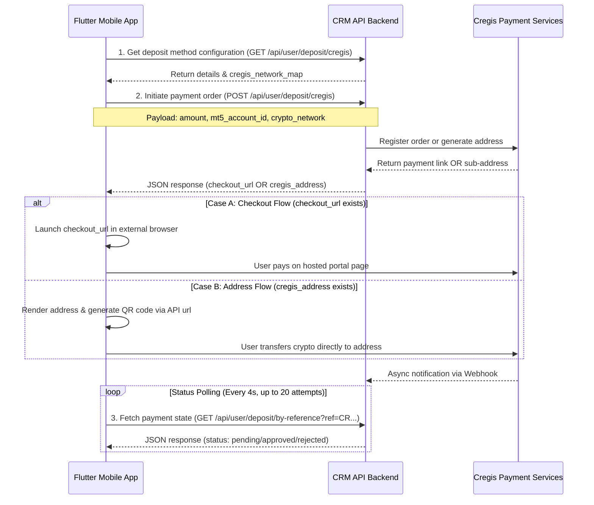

# Flutter Integration Guide: Cregis Crypto Gateway

This guide outlines how to integrate the **Cregis Crypto Payment Gateway** into the `crmapp` Flutter application. The implementation mirrors the exact business logic, UI rules, and polling workflows used in the Vue-based Web Frontend (`crmfronend`).

---

## 1. Sequence & Architecture Flow

The backend supports two operation modes for Cregis deposits depending on admin configurations:
1. **Checkout Flow (`checkout` / `auto`)**: The API registers a checkout order and returns a hosted payment portal URL (`checkout_url`). The mobile app opens this URL in an external browser.
2. **Address Flow (`address`)**: The API generates a unique, on-chain crypto deposit address (`cregis_address`) for the payment. The mobile app renders this address and its QR code representation directly inside the app.

In both flows, the app does not require uploading proof screenshots (unlike manual deposits) and must poll the backend transaction status periodically to verify confirmation.



---

## 2. Step-by-Step Codebase Implementation

Follow these steps to modify files in the `crmapp` repository:

### Step 2.1: Add API Endpoints
File: [api_const.dart](file:///Users/admin/Documents/Projects/Tenax/crmapp/lib/constants/api_const.dart)

Add the Cregis deposit and status endpoints inside `class ApiConstants`:

```dart
  // Cregis Crypto Gateway Endpoints
  static const String cregisDeposit = '${ajax}deposit/cregis';
  static const String getDepositByReference = '${ajax}deposit/by-reference';
```

---

### Step 2.2: Implement Logic in Controller
File: [deposit_controller.dart](file:///Users/admin/Documents/Projects/Tenax/crmapp/lib/controllers/finance/deposit_controller.dart)

1. **Add State Variables**:
   Add observables to hold the selected network and the Cregis API response:
   ```dart
   final selectedCregisNetwork = ''.obs;
   final cregisDepositResult = Rxn<Map<String, dynamic>>();
   ```

2. **Network Mapping Helper**:
   Define supported networks, matching the web-frontend's `CREGIS_NETWORK_LABELS`:
   ```dart
   static const Map<String, String> cregisNetworkLabels = {
     'trc20': 'TRC-20 (TRON)',
     'erc20': 'ERC-20 (Ethereum)',
     'bep20': 'BEP-20 (BSC)',
     'polygon': 'Polygon',
   };

   // Check if the current payment method is Cregis
   bool get isCregis {
     final type = selectedPaymentMethod.value?['gateway_type'] ?? 
                  selectedPaymentMethod.value?['type'] ?? '';
     return type.toString().toLowerCase() == 'cregis';
   }

   // Extract available network choices based on admin configurations
   List<Map<String, String>> get cregisNetworkOptions {
     final map = depositMethod.value?['cregis_network_map'];
     if (map is Map<String, dynamic>) {
       final configuredKeys = cregisNetworkLabels.keys.where((key) {
         final row = map[key];
         return row != null && row['chain_id']?.toString().trim().isNotEmpty == true;
       }).toList();

       if (configuredKeys.isNotEmpty) {
         return configuredKeys.map((key) => {
           'slug': key,
           'label': cregisNetworkLabels[key]!,
         }).toList();
       }
     }
     // Fallback to all networks if map is empty/invalid
     return cregisNetworkLabels.entries.map((e) => {
       'slug': e.key,
       'label': e.value,
     }).toList();
   }
   ```

3. **Initiate Payment Request**:
   Add a method to submit the payment request:
   ```dart
   Future<Map<String, dynamic>?> submitCregisDeposit({
     required String mt5AccountId,
     required double amount,
     required String cryptoNetwork,
     String? depositSlug,
   }) async {
     try {
       _setLoading(true);
       _clearError();
       final token = await SecureStorageService.getAuthToken();

       // Setup payload fields corresponding to backend API requirements
       final requestData = {
         'gateway_method_id': depositSlug ?? 'cregis',
         'mt5_account_id': mt5AccountId,
         'amount': amount.toString(),
         'crypto_network': cryptoNetwork,
       };

       final response = await ApiService.post(
         endpoint: ApiConstants.cregisDeposit,
         token: token,
         data: requestData,
       );

       if (response.success && response.data != null) {
         final responseMap = response.data as Map<String, dynamic>;
         final data = responseMap['data'] as Map<String, dynamic>?;
         if (data != null) {
           cregisDepositResult.value = data;
           return data;
         }
       }
       
       CustomToastService.showError(
         message: response.message ?? 'Failed to create Cregis deposit',
       );
       return null;
     } catch (e) {
       CustomToastService.showError(message: 'Error creating Cregis deposit: $e');
       return null;
     } finally {
       _setLoading(false);
     }
   }
   ```

4. **Verify Payment Status**:
   Add a status-check method:
   ```dart
   Future<Map<String, dynamic>?> getCregisDepositStatus(String refNumber) async {
     try {
       final token = await SecureStorageService.getAuthToken();
       final response = await ApiService.get(
         endpoint: ApiConstants.getDepositByReference,
         token: token,
         queryParameters: {'ref': refNumber},
       );

       if (response.success && response.data != null) {
         final responseMap = response.data as Map<String, dynamic>;
         return responseMap['data'] as Map<String, dynamic>?;
       }
       return null;
     } catch (e) {
       print('Error checking Cregis status: $e');
       return null;
     }
   }
   ```

---

### Step 2.3: Modify Deposit Selection Screen
File: [deposit_real_screen.dart](file:///Users/admin/Documents/Projects/Tenax/crmapp/lib/screens/home/more/finance/deposit_real_screen.dart)

1. **Auto-select Default Network**:
   In `initState()`, if the payment gateway is Cregis, automatically select the first network option:
   ```dart
   if (controller.isCregis) {
     final options = controller.cregisNetworkOptions;
     if (options.isNotEmpty) {
       controller.selectedCregisNetwork.value = options.first['slug']!;
     }
   }
   ```

2. **Network Selection Dropdown Widget**:
   Insert a network selector dropdown in the screen's Column when `controller.isCregis` is true:
   ```dart
   Obx(() {
     if (!controller.isCregis) return const SizedBox.shrink();
     
     final networks = controller.cregisNetworkOptions;
     return Padding(
       padding: EdgeInsets.only(bottom: 24.h),
       child: DropdownButtonFormField<String>(
         value: controller.selectedCregisNetwork.value.isEmpty ? null : controller.selectedCregisNetwork.value,
         decoration: InputDecoration(
           labelText: 'Crypto Network',
           contentPadding: EdgeInsets.symmetric(horizontal: 16.w, vertical: 16.h),
           border: OutlineInputBorder(borderRadius: BorderRadius.circular(12)),
         ),
         items: networks.map((net) {
           return DropdownMenuItem<String>(
             value: net['slug'],
             child: Text(net['label']!),
           );
         }).toList(),
         onChanged: (val) {
           if (val != null) {
             controller.selectedCregisNetwork.value = val;
           }
         },
       ),
     );
   })
   ```

3. **Exclude Screenshot Upload UI**:
   Ensure any manual screenshot/upload receipt container is completely hidden for Cregis:
   ```dart
   if (!controller.isCregis) ...[
     // Original manual deposit screenshot widgets go here...
   ]
   ```

4. **Update Submission Logic**:
   Modify the `_handleDeposit()` method. If Cregis is selected, request address generation or payment URL, and transition appropriately:
   ```dart
   void _handleDeposit() async {
     if (amountController.text.isEmpty || double.tryParse(amountController.text) == null) {
       CustomToastService.showError(message: 'Please enter a valid amount');
       return;
     }

     final amount = double.parse(amountController.text);
     final accountId = controller.selectedTransferAccount.value!['meta_account_number'].toString();

     if (controller.isCregis) {
       final result = await controller.submitCregisDeposit(
         mt5AccountId: accountId,
         amount: amount,
         cryptoNetwork: controller.selectedCregisNetwork.value,
         depositSlug: widget.object['deposit_slug'],
       );

       if (result != null) {
         final checkoutUrl = result['checkout_url']?.toString();
         final cregisAddress = result['cregis_address']?.toString();
         final referenceNumber = result['reference_number']?.toString() ?? '';

         if (checkoutUrl != null && checkoutUrl.isNotEmpty) {
           // Checkout Mode: launch URL external webview
           await launchUrlString(checkoutUrl, mode: LaunchMode.externalApplication);
           // Navigate user to polling/verification view
           Get.to(() => CregisSuccessScreen(
             referenceNumber: referenceNumber,
             amount: amount,
           ));
         } else if (cregisAddress != null && cregisAddress.isNotEmpty) {
           // Address Mode: Navigate to address instructions screen
           Get.to(() => CregisAddressScreen(
             cregisAddress: cregisAddress,
             referenceNumber: referenceNumber,
             amount: amount,
             networkLabel: DepositController.cregisNetworkLabels[result['crypto_network']] ?? 'USDT',
           ));
         }
       }
     } else {
       // Proceed with normal manual deposit instructions navigation
       Get.to(() => DepositInstructionScreen(
         object: controller.depositMethod.value!,
         amountString: amountController.text,
         selectedMT5AccountID: accountId,
       ));
     }
   }
   ```

---

### Step 2.4: Create Cregis Success & Address Screens
Create new Flutter screen widgets to display direct deposit address details and manage the status polling loop.

#### Screen A: Address Display View (`CregisAddressScreen`)
This screen represents the direct address generation layout. Make sure to generate the QR code using the dynamic URL generator:
`https://api.qrserver.com/v1/create-qr-code/?size=220x220&data=${Uri.encodeComponent(cregisAddress)}`

```dart
import 'dart:async';
import 'package:flutter/material.dart';
import 'package:flutter/services.dart';
import 'package:get/get.dart';
import 'package:crm_app/controllers/finance/deposit_controller.dart';
import 'package:crm_app/widgets/custom_toast.dart';
import 'package:crm_app/routes/app_pages.dart';

class CregisAddressScreen extends StatefulWidget {
  final String cregisAddress;
  final String referenceNumber;
  final double amount;
  final String networkLabel;

  const CregisAddressScreen({
    super.key,
    required this.cregisAddress,
    required this.referenceNumber,
    required this.amount,
    required this.networkLabel,
  });

  @override
  State<CregisAddressScreen> createState() => _CregisAddressScreenState();
}

class _CregisAddressScreenState extends State<CregisAddressScreen> {
  final DepositController controller = Get.find<DepositController>();
  Timer? _pollingTimer;
  int _attempts = 0;
  final int _maxAttempts = 20; // Maximum 80 seconds

  @override
  void initState() {
    super.initState();
    _startStatusPolling();
  }

  @override
  void dispose() {
    _pollingTimer?.cancel();
    super.dispose();
  }

  void _startStatusPolling() {
    _pollingTimer = Timer.periodic(const Duration(seconds: 4), (timer) async {
      _attempts++;
      if (_attempts > _maxAttempts) {
        timer.cancel();
        CustomToastService.showWarning(
          message: 'Verification timeout. Check status in transaction history later.',
          title: 'Status Pending',
        );
        return;
      }

      final data = await controller.getCregisDepositStatus(widget.referenceNumber);
      if (data != null) {
        final status = data['status']?.toString().toLowerCase();
        if (status == 'approved' || status == 'confirmed') {
          timer.cancel();
          CustomToastService.showSuccess(message: 'Deposit confirmed! Balance updated.');
          Get.offAllNamed(Routes.TRANSACTION_HISTORY, arguments: {'from': 'finance'});
        } else if (status == 'rejected' || status == 'failed') {
          timer.cancel();
          CustomToastService.showError(message: 'Deposit payment rejected.');
          Get.offAllNamed(Routes.TRANSACTION_HISTORY, arguments: {'from': 'finance'});
        }
      }
    });
  }

  @override
  Widget build(BuildContext context) {
    final qrUrl = 'https://api.qrserver.com/v1/create-qr-code/?size=220x220&data=${Uri.encodeComponent(widget.cregisAddress)}';
    
    return Scaffold(
      appBar: AppBar(title: const Text('Direct Crypto Transfer')),
      body: SingleChildScrollView(
        padding: const EdgeInsets.all(24.0),
        child: Column(
          children: [
            Text('Send ${widget.amount.toStringAsFixed(2)} USD using network:', style: const TextStyle(fontSize: 16)),
            Text(widget.networkLabel, style: const TextStyle(fontSize: 20, fontWeight: FontWeight.bold, color: Colors.blue)),
            const SizedBox(height: 24),
            
            // QR Code Render
            Center(
              child: Image.network(
                qrUrl,
                height: 200,
                width: 200,
                loadingBuilder: (context, child, loadingProgress) {
                  if (loadingProgress == null) return child;
                  return const SizedBox(height: 200, child: Center(child: CircularProgressIndicator()));
                },
              ),
            ),
            const SizedBox(height: 24),
            
            // Copy Address block
            ListTile(
              title: const Text('Deposit Wallet Address', style: TextStyle(fontSize: 12)),
              subtitle: Text(widget.cregisAddress, style: const TextStyle(fontSize: 14, fontFamily: 'monospace')),
              trailing: IconButton(
                icon: const Icon(Icons.copy),
                onPressed: () {
                  Clipboard.setData(ClipboardData(text: widget.cregisAddress));
                  CustomToastService.showSuccess(message: 'Address copied');
                },
              ),
            ),
            
            const SizedBox(height: 16),
            Text('Reference: ${widget.referenceNumber}', style: const TextStyle(color: Colors.grey)),
            const SizedBox(height: 32),
            const CircularProgressIndicator(),
            const SizedBox(height: 12),
            const Text('Awaiting network confirmation...', style: TextStyle(fontStyle: FontStyle.italic)),
          ],
        ),
      ),
    );
  }
}
```

---

#### Screen B: Checkout Success View (`CregisSuccessScreen`)
This screen represents the hosted checkout checking view. It displays a loading spinner and checks for webhook payment confirmation in the background.

```dart
import 'dart:async';
import 'package:flutter/material.dart';
import 'package:get/get.dart';
import 'package:crm_app/controllers/finance/deposit_controller.dart';
import 'package:crm_app/widgets/custom_toast.dart';
import 'package:crm_app/routes/app_pages.dart';

class CregisSuccessScreen extends StatefulWidget {
  final String referenceNumber;
  final double amount;

  const CregisSuccessScreen({
    super.key,
    required this.referenceNumber,
    required this.amount,
  });

  @override
  State<CregisSuccessScreen> createState() => _CregisSuccessScreenState();
}

class _CregisSuccessScreenState extends State<CregisSuccessScreen> {
  final DepositController controller = Get.find<DepositController>();
  Timer? _pollingTimer;
  int _attempts = 0;
  final int _maxAttempts = 20;

  @override
  void initState() {
    super.initState();
    _startStatusPolling();
  }

  @override
  void dispose() {
    _pollingTimer?.cancel();
    super.dispose();
  }

  void _startStatusPolling() {
    _pollingTimer = Timer.periodic(const Duration(seconds: 4), (timer) async {
      _attempts++;
      if (_attempts > _maxAttempts) {
        timer.cancel();
        Get.offAllNamed(Routes.TRANSACTION_HISTORY, arguments: {'from': 'finance'});
        return;
      }

      final data = await controller.getCregisDepositStatus(widget.referenceNumber);
      if (data != null) {
        final status = data['status']?.toString().toLowerCase();
        if (status == 'approved' || status == 'confirmed') {
          timer.cancel();
          CustomToastService.showSuccess(message: 'Deposit successful!');
          Get.offAllNamed(Routes.TRANSACTION_HISTORY, arguments: {'from': 'finance'});
        } else if (status == 'rejected' || status == 'failed') {
          timer.cancel();
          CustomToastService.showError(message: 'Payment was rejected.');
          Get.offAllNamed(Routes.TRANSACTION_HISTORY, arguments: {'from': 'finance'});
        }
      }
    });
  }

  @override
  Widget build(BuildContext context) {
    return Scaffold(
      body: Center(
        child: Padding(
          padding: const EdgeInsets.all(24.0),
          child: Column(
            mainAxisAlignment: MainAxisAlignment.center,
            children: [
              const Icon(Icons.check_circle_outline, size: 80, color: Colors.green),
              const SizedBox(height: 24),
              const Text('Payment Request Submitted', style: TextStyle(fontSize: 22, fontWeight: FontWeight.bold)),
              const SizedBox(height: 12),
              Text('Checking status for Reference: ${widget.referenceNumber}', textAlign: TextAlign.center),
              const SizedBox(height: 32),
              const CircularProgressIndicator(),
              const SizedBox(height: 16),
              const Text('Verifying payment details...'),
              const SizedBox(height: 48),
              ElevatedButton(
                onPressed: () {
                  _pollingTimer?.cancel();
                  Get.offAllNamed(Routes.TRANSACTION_HISTORY, arguments: {'from': 'finance'});
                },
                child: const Text('Go to Transaction History'),
              ),
            ],
          ),
        ),
      ),
    );
  }
}
```

---

## 3. Crucial Rules & Constraints Checklist
- **No Screenshot Upload**: Do NOT require file uploads when `isCregis` matches true. Payment confirmation relies purely on the background webhook verification.
- **Interval & Timeout Parameters**: Poll the `/by-reference` state exactly every **4 seconds**, with a maximum count cap of **20 attempts** before stopping the timer.
- **URL Handling**: Ensure that `url_launcher` supports launching external web links using `LaunchMode.externalApplication` or equivalent for iOS/Android configurations.
