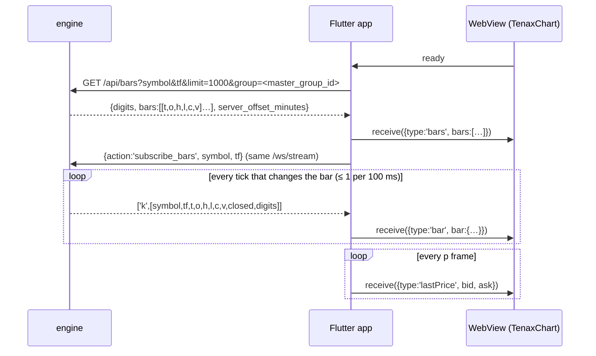

# Tenax Chart in a Flutter app

Read [how it works](./integration.md) first — the order model, the confirm rule
and the SL/TP lifecycle are the same on every platform. This page is the Flutter
wiring; the web is [here](./web.md).

The library is DOM + canvas TypeScript, so on Flutter it runs inside a WebView.
That is not a workaround — TradingView's own mobile SDK works the same way. What
matters is that the WebView is a **view**, not a second client: the app keeps the
socket, the session and the order state, and pushes data in.

## 1. Build and bundle the assets

```bash
npm run pack:mobile
```

That writes `mobile/assets/chart/` and zips it as
`tenax-chart-mobile-<version>.zip` — the obfuscated bundle, the stylesheet and
the host page, ready to drop in:

```
assets/chart/
├── index.html              generated, carries the version it was built from
├── tenax-chart.umd.cjs     ~680 KB (246 KB zipped)
└── tenax-chart.css          ~29 KB
```

Use that script rather than `npm run build`, whose output is plain readable
source. A WebView asset sits in the app bundle where anyone can unzip it, so it
is the last place unobfuscated code should land.

`pubspec.yaml`:

```yaml
flutter:
  assets:
    - assets/chart/
```

Bundle them rather than loading a URL. 400 KB opens instantly, works offline,
and cannot show a blank screen because the network was slow.

`assets/chart/index.html` comes out of the pack, so a chart release carries its
own host page and the app never edits HTML. For reference, this is what it does
— boot values can also arrive as `?symbol=&interval=&theme=&offset=` on the
asset URL, and everything here can still be changed later by message:

```html
<!doctype html>
<html>
  <head>
    <meta charset="UTF-8" />
    <meta name="viewport"
      content="width=device-width, initial-scale=1, maximum-scale=1, user-scalable=no, viewport-fit=cover" />
    <link rel="stylesheet" href="tenax-chart.css" />
    <style>
      html, body { margin: 0; height: 100%; overscroll-behavior: none; background: #131722; }
      #app { position: fixed; inset: 0;
             padding: env(safe-area-inset-top) env(safe-area-inset-right)
                      env(safe-area-inset-bottom) env(safe-area-inset-left);
             box-sizing: border-box; }
    </style>
  </head>
  <body>
    <div id="app"></div>
    <script src="tenax-chart.umd.cjs"></script>
    <script>
      TenaxChart.mountBridge(document.getElementById('app'), {
        symbol: 'BTCUSD',
        interval: '15m',
        datafeed: { mode: 'push', displayOffsetMinutes: -120 },
        orders: { contractSize: 1, allowDrag: true, allowClose: true },
      });
    </script>
  </body>
</html>
```

`user-scalable=no` matters: the chart pinch-zooms its own time scale, and the
browser zooming the page on top of that fights it.

## 2. The Dart side

```dart
import 'dart:convert';
import 'package:flutter_inappwebview/flutter_inappwebview.dart';

class TenaxChartView extends StatefulWidget {
  const TenaxChartView({super.key});
  @override
  State<TenaxChartView> createState() => _TenaxChartViewState();
}

class _TenaxChartViewState extends State<TenaxChartView> {
  InAppWebViewController? _controller;

  /// App → chart.
  Future<void> _send(Map<String, dynamic> message) async {
    await _controller?.evaluateJavascript(
      source: 'TenaxChart.receive(${jsonEncode(message)})',
    );
  }

  @override
  Widget build(BuildContext context) {
    return InAppWebView(
      initialFile: 'assets/chart/index.html',
      initialSettings: InAppWebViewSettings(
        transparentBackground: true,
        supportZoom: false,
        // Canvas is the whole point here; without it Android scrolls at 20fps.
        useHybridComposition: true,
      ),
      onWebViewCreated: (controller) {
        _controller = controller;

        // Chart → app. One handler carries every message type.
        controller.addJavaScriptHandler(
          handlerName: 'tenaxchart',
          callback: (args) {
            final msg = args.first as Map<String, dynamic>;
            switch (msg['type']) {
              case 'ready':
                _pushEverything();
                break;

              case 'orderModify':
                // The chart has NOT applied this. It shows the level dashed and
                // waits. Call the broker, then confirm — or say nothing and the
                // old price stands.
                api.modifyOrder(
                  orderId: msg['orderId'],
                  field: msg['kind'],          // 'sl' | 'tp' | 'pending'
                  price: (msg['to'] as num).toDouble(),
                ).then((updated) {
                  _send({'type': 'order', 'action': 'upsert', 'order': updated});
                }).catchError((e) {
                  showError(e);   // no confirm → the chart keeps the old level
                });
                break;

              case 'orderClose':
                api.closeOrder(msg['orderId']).then((_) {
                  _send({'type': 'order', 'action': 'remove', 'orderId': msg['orderId']});
                });
                break;

              case 'orderLevelRemove':
                api.modifyOrder(orderId: msg['orderId'], field: msg['kind'], price: null)
                   .then((updated) {
                  _send({'type': 'order', 'action': 'upsert', 'order': updated});
                });
                break;

              case 'orderFocus':
                // The user picked an order on the chart — highlight the same
                // row in the app's own list.
                setState(() => selectedIds = List<String>.from(msg['orderIds']));
                break;

              case 'error':
                debugPrint('[chart] ${msg['message']}');
                break;
            }
            return null;
          },
        );
      },
    );
  }

  Future<void> _pushEverything() async {
    await _send({'type': 'candles', 'bars': await api.history('BTCUSD', '15m')});
    await _send({
      'type': 'orders',
      'positions': positions.map((p) => p.toChartJson()).toList(),
      'pendings': pendings.map((o) => o.toChartJson()).toList(),
    });

    // Feed the socket the app already has. No second connection.
    priceSocket.stream.listen((t) {
      _send({'type': 'tick', 'bid': t.bid, 'ask': t.ask});
    });
    orderSocket.stream.listen((event) {
      _send(event.closed
          ? {'type': 'order', 'action': 'remove', 'orderId': event.id}
          : {'type': 'order', 'action': 'upsert', 'order': event.order.toChartJson()});
    });
  }
}
```

## 2b. Server bars — the feed to use (0.2.1+)

The `candles` + `tick` pair above makes the **chart** build the live candle from
ticks. That is the legacy path and it is why web candles used to differ from
MT5 (open off the previous close, short wicks). The engine now builds every
candle on the server — `GET /api/bars` and the `k` frame on `/ws/stream` — and
the chart only draws what it is told. On mobile the app is the relay: it already
holds the stream socket, so it forwards bars into the WebView as `bars` /
`bar` / `lastPrice`. No second socket, no candle maths in Dart or in JS.



**Host page** — unchanged from section 1 (`datafeed.mode: 'push'`; the
`bars` / `bar` / `lastPrice` messages work in that mode). The one thing to get
right at boot is the display offset: the axis must follow the series' clock, and
that is a mount-time value. Read `server_offset_minutes` from one `/api/bars`
call before opening the WebView and pass it on the asset URL:

```dart
// Android; iOS loads the same file from the app bundle. `initialFile` cannot carry a query.
initialUrlRequest: URLRequest(url: WebUri(
  'file:///android_asset/flutter_assets/assets/chart/index.html'
  '?symbol=XAUUSD&interval=1m&offset=$serverOffsetMinutes')),
```

(the page reads `?symbol=&interval=&theme=&offset=`, see section 1). A broker's
MT5 server clock does not change between logins, so cache it with the session.
Known gap: the bridge has no `displayOffset` message yet, so the offset cannot be
changed after mount without reloading the page — that message is the planned
fix; until then a broker switch inside one session reloads the WebView.

**Dart** — one class owns the relay. It is the only place that knows the wire
shapes; the rest of the app just calls `open(symbol, tf)`.

```dart
class ChartBarsRelay {
  ChartBarsRelay({required this.send, required this.stream, required this.api, required this.masterGroupId});

  final Future<void> Function(Map<String, dynamic>) send;   // TenaxChart.receive(...)
  final EngineStream stream;                                // the app's existing /ws/stream client
  final EngineApi api;
  final int masterGroupId;                                  // the account's master_group_id — wrong id = wrong markup

  String? _symbol, _tf;
  Timer? _refresh;

  /// Timeframe load / symbol switch. The same call serves both.
  Future<void> open(String symbol, String tf) async {
    if (_symbol != null && _symbol != symbol) {
      stream.send({'action': 'unsubscribe_bars', 'symbol': _symbol});
    }
    _symbol = symbol; _tf = tf;

    final res = await api.get('/api/bars', {
      'symbol': symbol, 'tf': tf, 'limit': '1000', 'group': '$masterGroupId',
    });
    final digits = res['digits'] as int;
    await send({
      'type': 'bars',
      'bars': [for (final r in res['bars'] as List) _bar(r, digits, closed: r != (res['bars'] as List).last)],
    });

    // a second subscribe
    stream.send({'action': 'subscribe_bars', 'symbol': symbol, 'tf': tf});

    _refresh?.cancel();
    _refresh = Timer.periodic(const Duration(seconds: 2), (_) => _tail());
  }

  /// Wire the two stream channels once, at construction.
  void attach() {
    stream.onFrame('k', (List f) {
      // ['k', [symbol, tf, t, o, h, l, c, v, closed, digits]]
      final d = f[9] as int;                                  // digits OF THE FRAME, not of the history response
      send({'type': 'bar', 'bar': {
        'symbol': f[0], 'interval': f[1],                     // the chart drops a frame of another symbol / tf
        ..._bar([f[2], f[3], f[4], f[5], f[6], f[7]], d, closed: f[8] == 1),
      }});
      if (f[8] == 1) _tail();                                 // a closed bar: re-read the tail at once
    });
    stream.onFrame('p', (price) {
      // moves the Bid/Ask/last-price lines and the order P&L only — never the candle
      send({'type': 'lastPrice', 'symbol': price.symbol, 'bid': price.bid, 'ask': price.ask});
    });
  }

  /// A lost frame must never leave a wrong candle: the last three bars, served from the engine's memory.
  Future<void> _tail() async {
    if (_symbol == null) return;
    final res = await api.get('/api/bars', {'symbol': _symbol!, 'tf': _tf!, 'limit': '3', 'group': '$masterGroupId'});
    final digits = res['digits'] as int;
    final rows = res['bars'] as List;
    for (final r in rows) {
      await send({'type': 'bar', 'bar': {'symbol': _symbol, 'interval': _tf, ..._bar(r, digits, closed: r != rows.last)}});
    }
  }

  void dispose() {
    _refresh?.cancel();
    if (_symbol != null) stream.send({'action': 'unsubscribe_bars', 'symbol': _symbol});
  }

  static Map<String, dynamic> _bar(List r, int digits, {required bool closed}) {
    final k = math.pow(10, digits).toDouble();
    return {'time': r[0], 'open': r[1] / k, 'high': r[2] / k, 'low': r[3] / k, 'close': r[4] / k, 'volume': r[5], 'closed': closed};
  }
}
```

Rules that keep it honest:

* **`group` is mandatory in practice.** Pass the account's `master_group_id`; without it the engine serves the symbol's default series — another markup, or for a self-hosted symbol the raw feed.
* **Divide by the frame's own `digits`** (`f[9]`), never by the history response's. A feed's digits can be corrected by its first tick.
* **Pause when hidden.** Stop the 2 s tail refresh and `unsubscribe_bars` in `AppLifecycleState.paused`; on resume call `open()` again (it reloads history, so the gap is filled). Each connection carries at most 4 bar subscriptions.
* **Self-hosted accounts** work the same way — the engine builds their candles from the broker's datafeed and serves history from its own store, with the group markup applied on the way out. The app does nothing different.
* `candles` / `tick` still work for a host that cannot reach `/api/bars`, but do not mix the two paths on one chart.

## 3. Message reference

**App → chart** — `TenaxChart.receive({...})`

| type | fields |
|---|---|
| `symbol` | `symbol`, `interval?` |
| `interval` | `interval` |
| `bars` | `bars: [{ time, open, high, low, close, volume?, closed? }]` — server bars, replaces the series; `time` in **seconds**, display zone |
| `bar` | `bar: { time, open, high, low, close, volume?, closed?, symbol?, interval? }` — upsert one bar by time; dropped if `symbol`/`interval` differ from the chart's |
| `lastPrice` | `bid`, `ask?`, `price?`, `symbol?` — moves the price lines and P&L only |
| `candles` | `bars: [{ time, open, high, low, close, volume }]` — legacy push mode (chart builds the live candle) |
| `tick` | `bid`, `ask`, `symbol?` — legacy push mode |
| `symbols` | `list: [{ name, displayName, category, digits }]` — feeds the search; tabs come from `category` |
| `orders` | `positions?`, `pendings?` — full snapshot |
| `order` | `action: 'upsert' \| 'remove'`, `order` / `orderId` |
| `focus` | `orderIds: []` — show only these, `[]` shows all |
| `theme` | `mode: 'dark' \| 'light'` |
| `chartType` | `value: 'candlestick' \| 'heikin' \| 'line' \| …` |
| `config` | `theme?`, `orders?` — per-broker palette and settings, applied live |
| `resetZoom` | — |
| `scrollLock` | `on: boolean` — price axis stops auto-scaling (remembered) |
| `chartShift` | `on: boolean` — MT5 gap right of the live candle (remembered) |

**Chart → app** — the `tenaxchart` handler

| type | fields | meaning |
|---|---|---|
| `ready` | — | mounted; push the first data |
| `orderModify` | `orderId`, `kind`, `from`, `to`, `order` | user dragged or added a level (`from: null` = added) |
| `orderClose` | `orderId` | ✕ pressed |
| `orderLevelRemove` | `orderId`, `kind` | 🗑 on an SL/TP |
| `orderFocus` | `orderIds` | selection changed |
| `error` | `message` | |

## 4. Where the config lives

Three layers, and only the first is baked into the bundle:

1. **Boot defaults** — the `mountBridge({...})` call in `assets/chart/index.html`.
   Symbol, interval, push mode, sensible fallbacks. Same for every broker.

2. **Per broker, at runtime** — the app sends `config` after login, so one
   bundle serves every white label without a rebuild:

   ```dart
   _send({
     'type': 'config',
     'theme':  {'up': '#26a69a', 'down': '#ef5350', 'bg': '#0e1117'},
     'orders': {
       'contractSize': 100000,      // FX; 1 for BTC
       'tickSize': 0.00001,
       'stopLevelPoints': 30,       // broker's minimum distance
       'allowDrag': true,
       'allowClose': true,
       'maxVisibleLabels': 15,      // lower on old Android
       'colors': {'buy': '#2962ff', 'slBoxBg': '#ffe3e3', 'tpBoxBg': '#dff5e5'},
     },
   });
   ```

   Pull those values from the broker settings the app already fetches — the
   chart should not know which broker it is.

3. **Per user** — text size, drawing toolbar side, favourite intervals, saved
   layouts and drawings. The chart stores these in the WebView's localStorage
   itself; nothing to wire.

## 5. Order shape

```json
{ "id": "12345", "side": "buy", "volume": 0.1,
  "entry": 62907.35, "sl": 62727.35, "tp": null,
  "profit": 4.50, "editable": true }
```

`sl`/`tp` are optional. `profit` is optional — without it the chart estimates
from `contractSize`, but the server's number always wins.

Pending orders take `kind: 'limit' | 'stop'` and `price` instead of `entry`.

## 6. SL/TP from the app side

The chart offers three ways in, and they all end at the same event:

| Trader does | You get |
|---|---|
| drags the ⠿ grip or the line | `orderModify` with `from` = old price |
| taps **SL** / **TP** on the pill, then taps a price | `orderModify` with `from: null` |
| taps 🗑 on an SL/TP pill | `orderLevelRemove` |

So one Dart handler covers moving, adding and clearing:

```dart
Future<void> _applyLevel(Map msg, {required bool clear}) async {
  final id = msg['orderId'] as String;
  final field = msg['kind'] as String;        // 'sl' | 'tp' | 'pending'
  try {
    final updated = await api.modifyOrder(
      orderId: id,
      field: field,
      price: clear ? null : (msg['to'] as num).toDouble(),
    );
    await _send({'type': 'order', 'action': 'upsert', 'order': updated});
  } catch (e) {
    showError(e);        // no reply → the chart puts the level back after 10s
  }
}
```

The chart has already refused anything the broker would: an SL on the wrong side
of the entry, a level inside `stopLevelPoints`, a price off the tick. Those never
reach your API.

## 7. Things that bite

- **Nothing is applied optimistically.** A drag, an added level and a deleted
  one all report and wait. **Every one of them needs a reply** — answer with
  `order upsert` (or `remove`) once the broker accepts. Skip the reply and the
  button looks broken: the level just sits in its waiting state.
  `orders.confirmTimeoutMs` (10s by default) is the backstop — after it the
  chart puts the level back and fires `orderTimeout`, so tell the user why.
- **One socket.** Push mode means the chart opens no connection of its own.
  Leave `historyUrl`/`wsUrl` out of the config.
- **`time` is in seconds**, and already shifted into the display zone by
  `displayOffsetMinutes`. Send milliseconds and the bars land in 1970.
- **Old Android WebViews** are slower at canvas. If a big account feels heavy,
  drop `orders.maxVisibleLabels` (40 → 15) and raise `clusterWithinPx` (8 → 14).
- **Keyboard.** `position: fixed` on `#app` keeps the layout put when the
  keyboard opens; `height: 100vh` does not on Android.
- **Touch is handled.** Drag, the SL/TP buttons, ✕ and 🗑 all run on pointer
  events, and touch gets a 14px larger reach than a mouse — a thumb lands on
  the line without hitting it exactly. While a level is being dragged the
  element takes `touch-action: none`, so the page cannot scroll underneath.
