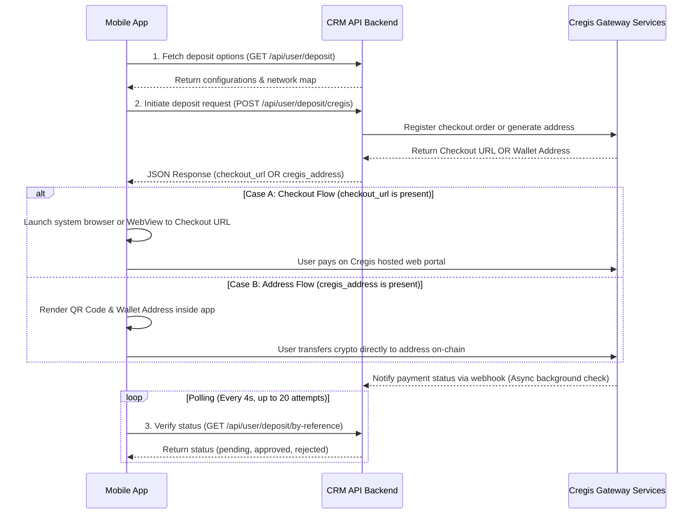

# API Reference Guide: Cregis Gateway Mobile App Integration

This document outlines the API details, endpoints, payloads, and communication workflow required to integrate the **Cregis Crypto Payment Gateway** into a mobile application. Use this reference to implement the API calls and payment flows on any mobile framework (such as Flutter, React Native, iOS Native, or Android Native).

---

## 1. Gateway Overview & Flow Architecture

The backend supports two operation modes for Cregis payments:

1. **Checkout Flow (`checkout` or `auto`)**: The backend calls Cregis Payment Engine API to register a transaction order. The backend API returns a hosted payment page URL (`checkout_url`). The mobile app redirects the user to this URL to execute their transfer.
2. **Address Flow (`address` / Direct sub-address generation)**: The backend API calls the Cregis Wallet API to generate a unique on-chain deposit address (`cregis_address`) for the user's specific request. The mobile app renders this address text and its corresponding QR code inside the app.

Once payment is sent by the user, Cregis notifies the backend via webhook asynchronously. The mobile app verifies completion by polling the transaction status.



---

## 2. Authentication

All requests sent to the CRM API backend require a standard Sanctum Bearer token in the request headers:
* **Header**: `Authorization`
* **Value**: `Bearer <SANCTUM_TOKEN>`

---

## 3. Endpoints Specification

### 3.1 Fetch Deposit Methods Config
Retrieves the active gateways, parameters, limits, and supported crypto networks.
* **HTTP Method**: `GET`
* **Route**: `/api/user/deposit`
* **Response Details**:
  Look for the item where the `"gateway"` key equals `"cregis"`. Retrieve the following metadata:
  * `deposit_slug`: Key value to send as the gateway identifier (e.g., `"cregis"`).
  * `min_limit` & `max_limit`: Acceptable payment bounds.
  * `cregis_network_map`: A mapping of supported network slugs (keys) to backend labels (values) such as:
    * `"trc20"` $\rightarrow$ `"USDT-TRC20"`
    * `"erc20"` $\rightarrow$ `"USDT-ERC20"`
    * `"bep20"` $\rightarrow$ `"USDT-BEP20"`
    * `"polygon"` $\rightarrow$ `"USDT-POLYGON"`

---

### 3.2 Initiate Deposit Request
Generates either a checkout payment webpage link or a direct payment crypto address.
* **HTTP Method**: `POST`
* **Route**: `/api/user/deposit/cregis`
* **Content-Type**: `application/x-www-form-urlencoded` or `multipart/form-data`
* **Request Body Parameters**:
  | Parameter | Type | Required | Description |
  | :--- | :--- | :--- | :--- |
  | `gateway_method_id` | String | Yes | Pass the `deposit_slug` of the method (e.g., `"cregis"`). |
  | `mt5_account_id` | String | Yes | The target MT5 Account number or main Wallet ID where funds will deposit. |
  | `amount` | Decimal | Yes | The deposit value in USD (e.g. `150.00`). |
  | `crypto_network` | String | Yes | Key of the chosen network from the config mapping (e.g. `"trc20"`, `"erc20"`, `"bep20"`, `"polygon"`). |

#### Responses Schemas:

* **Response (Checkout Flow)**:
  If Cregis is configured in Checkout Mode, the JSON `data` contains a `checkout_url`:
  ```json
  {
    "status": true,
    "message": "Payment order created",
    "data": {
      "reference_number": "CR20260522103045",
      "amount": 100.0,
      "chain_id": "195",
      "crypto_network": "trc20",
      "checkout_url": "https://checkout.cregis.io/pay/order-xxxxxxxx",
      "cregis_id": "987654321",
      "account_number": "1002345"
    }
  }
  ```

* **Response (Address Flow)**:
  If configured in Direct Address Mode, `data` contains `cregis_address` instead of a checkout URL:
  ```json
  {
    "status": true,
    "message": "Deposit address created",
    "data": {
      "reference_number": "CR20260522103045",
      "amount": 100.0,
      "chain_id": "195",
      "crypto_network": "trc20",
      "cregis_address": "TY4hP364pY8s7v9aQw2xR...xxxxxx",
      "account_number": "1002345"
    }
  }
  ```

---

### 3.3 Poll Transaction Status
Checks whether the payment order has been paid and approved.
* **HTTP Method**: `GET`
* **Route**: `/api/user/deposit/by-reference`
* **Query Parameters**:
  * `ref`: The `reference_number` string returned during the creation step (e.g., `ref=CR20260522103045`).
* **Response Schema**:
  ```json
  {
    "status": true,
    "data": {
      "id": 456,
      "reference_number": "CR20260522103045",
      "amount": 100.00,
      "status": "approved", 
      "cregis_order_id": "987654321",
      "remarks": "Payment by Cregis - Amount: 100.00 USDT"
    }
  }
  ```
  * **Possible values for `"status"`**:
    * `"pending"`: Awaiting payment/confirmations.
    * `"approved"` / `"confirmed"`: Fully paid and credited.
    * `"rejected"`: Expired, partial payment error, or rejected by admin.
    * `"failed"`: Gateway error.

---

## 4. Mobile Client Business Logic Rules

Mobile developers must implement the following business logic patterns:

1. **Deposit Proof Exclusion**:
   Standard fiat deposits require submitting transaction proof files (receipts/screenshots) or manual transaction references. **Cregis transactions do NOT require receipts or screenshots**. Keep file uploads hidden or deactivated when a Cregis deposit is active.
2. **Handling Flow Branching**:
   Check the response from the initiation endpoint:
   * **If `checkout_url` is present**: Promptly open the URL via system browser or WebView.
   * **If `cregis_address` is present**: Display the raw string with a copy button, alongside a generated QR code representation of the address. Show a safety warning reminding the user to only transfer the selected crypto asset on the selected network (e.g., USDT on TRON).
3. **Background Polling Logic**:
   * Once a transaction is initiated, begin polling `/api/user/deposit/by-reference?ref=CR...` in the background.
   * **Interval**: Every 4 seconds.
   * **Timeout Limit**: Stop after 20 polling cycles (total 80 seconds). If it remains pending, instruct the user to check their status under the Transaction History screen later.
   * If status transitions to `"approved"` or `"confirmed"`, notify the user of credit success and redirect them to their balance/history layout.
   * If status transitions to `"rejected"` or `"failed"`, show a payment cancellation notice.
4. **App Resumption Check**:
   If the app goes to the background when loading the external Checkout URL, resume the status polling check when the app returns to the foreground.
